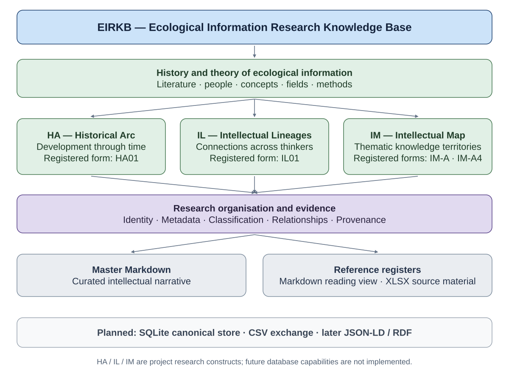

# EIRKB — Research Protocol

**Document version:** 1.4 (local restructuring, 26 October 2026). Historical protocol v1.3 and register edition 1.2 are preserved below. These are document versions, not a research release or approved DRM schema.

## Current authority and file roles

- `EIRKB_Machine_Reference.json` is the current structured-record authority after the validated migration. It preserves both original transcription fields and the existing structured representations; neither silently replaces the other.
- `EIRKB_Scientific_Reference_Register.md` and the three README tables are human-readable presentations of those records. Update structured records deliberately and keep their presentation tables consistent; do not edit the immutable migration transcription as current data.
- `A01_Historic_Arc.md`, `A02_Intellectual_Lineages.md` and `A03_Intellectual_Map.md` are the authorities for authored research prose, including local analysis and synthesis. JSON references them; it is not a competing editable prose store. A01–A03 identify documents, not replacement HA/IL/IM classification codes.
- Workbooks under `_legacy registers/` preserve legacy source bytes and filenames. They are not active authorities and were not re-audited in this migration. Historical workbook paths and source-sheet locators remain provenance, distinct from current working links.
- SQLite remains a future proposal requiring an explicitly approved, validated authority transition. The historical CSV/XLSX/SQLite operational proposals below are not implemented services or current authority.
- Issued IDs retain their exact forms, including R001–R156 and R0157. The historical four-digit alias/padding proposal below is superseded for issued legacy identifiers. New-identifier policy changes require explicit review; this migration allocates no new research IDs.
- HA, IL and IM remain project-specific analytical structures. Their definitions, category descriptions, possible memberships and actual assertions are different objects. The empty Classifications table remains empty; no memberships or historical-influence assertions were inferred.
- R0157 is the internal historical project protocol record, not a newly discovered external scholarly resource. It remains distinct from the present protocol document and its later version history.
- DRM is developing Database Reference Methodology. Shared conventions and mappings do not establish a detailed approved specification or EIRKB conformance. Source repositories retain authority; websites publish explicitly approved pinned views.

## Corpus, analysis and synthesis

Corpus means collected resources, entities, descriptions and provenance. Analysis is explicit examination and organisation of that corpus. Synthesis comprises arguments, frameworks and propositions developed from evidence and analysis. File role and epistemic status differ: registers may contain interpretations, and analytical prose may contain synthesis. EIRKB retains its local research and synthesis; IRKB has a proposed interdisciplinary/cross-database synthesis responsibility. DRM concerns shared conventions and mappings while source databases retain their authority.

This EIRKB structure is a pilot for a possible generic federation convention, not an architecture imposed on neighbouring repositories. Existing source-status terms, uncertainty, provenance tokens, bibliographic gaps and provisional genealogies remain intact. Transcription provenance is not independent bibliographic verification.

## Versions and preservation

README and scientific register document edition: 1.3. Research Protocol: 1.4, preserving historical v1.3. Machine document edition: 1.3; serialization schema: `eirkb.reference-register/0.1-draft`. No research release, DOI, licence, executable database schema or DRM certification is assigned. Original table versions and dates keep their historical meaning.

The [preservation crosswalk](EIRKB_Preservation_Crosswalk.json) records all source sections, original headings/anchors, row counts, hashes and destinations. [CHANGELOG](CHANGELOG.md) retains the complete Migration table and administrative history. Run `python3 scripts/validate_eirkb.py` after edits; the validator checks current JSON/table consistency, preserved source rows, links, controlled terms and deterministic diagram output. Retain evidence-backed unresolved mappings explicitly; do not resolve identities by numerical resemblance.

## Historical protocol and README — preserved context

The following original README material is preserved as historical design and research context. Its SQLite authority, canonical CSV/XLSX workflow, identifier-padding and old filename statements are superseded only where the current rules above explicitly say so. All research rationale, examples, governance, roadmap, unresolved questions and historical version decisions are retained. No implementation or canonical database is implied by this retained wording.

# Ecological Information Research Knowledge Base



*Documented research organisation; HA / IL / IM are project constructs, not universal classifications.* [View full-size diagram](assets/diagrams/eirkb_overview.svg).

**Work in Progress — Academic Research Resource**

EIRKB contains evolving research, provisional classifications and references undergoing verification.
Research by Jonathan Minchin, Ecological Interaction. See [CITATION.cff](CITATION.cff) for citation metadata and [CHANGELOG.md](CHANGELOG.md) for development history.

Research documents: [History and Theory of Ecological Information](MASTER_history_theory_ecological_information.md) and [Reference Register](EIRKB_Scientific_Reference_Register.md).

Planned research website: https://ecological-interaction.github.io/information/EIRKB/ (not deployed by this preparation).

## Project Definition, Architecture and Research Protocol

**Acronym:** EIRKB  
**Version:** 1.3  
**Status:** Approved design direction; defining / pre-implementation  
**Last major revision:** 2026-10-03  
**Canonical structured store:** SQLite (planned `eirkb.db`)  
**Tabular interchange format:** CSV  
**Human tabular interface:** XLSX  
**Intellectual narrative:** Markdown  
**Future semantic formats:** JSON-LD / RDF  
**Scope:** History and Theory of Ecological Information and subsequent situated ecological technology research

---

## 1. Purpose

The **Ecological Information Research Knowledge Base (EIRKB)** is a local-first research knowledge database and knowledge-organization protocol for recording and relating the literature, people, concepts, fields, methods, ecological phenomena, observations, places and technologies investigated through this research.

It serves two complementary purposes.

Academically, it provides a transparent means of organizing an interdisciplinary literature that cannot adequately be represented through a single chronological, disciplinary or bibliographic hierarchy.

Computationally, it provides stable identifiers, controlled classifications and explicit relationships from which timelines, reference registers, conceptual maps and eventually a semantic knowledge graph or ontology can be generated.

EIRKB does **not** replace conventional academic citation systems, library classifications or persistent scholarly identifiers. It supplements them with a project-specific analytical layer.

---

## 2. Research rationale

The research spans ecology, information theory, cybernetics, biosemiotics, environmental monitoring, Earth observation, industrial ecology, ecological economics, ecological design and related spatial and technological studies. A resource may participate in several fields and historical or theoretical contexts simultaneously.

Technology assessment likewise depends on situated ecological conditions, scale, materials, infrastructure, skills and cultural and economic conditions. Faceted classifications and explicit relationships preserve these intersections while keeping scholarly evidence distinct from the project's synthesis. This is a defensible research organization method, not a claim to a universal library classification or ontology.

Its fundamental principle is:

> **Stable entities, extensible metadata, multiple classifications, explicit relationships and traceable evidence.**

---

## 3. What EIRKB records

Every record separates five kinds of information.

### Identity

What is the thing?

`T0032`

### Metadata

What do we know about it?

Technology type, description, date, source, etc.

### Classification

Where does it participate within the research?

`HA`, `IL`, `IM`, scale, system domain, etc.

### Relationship

How does it connect to another entity?

`T0032 → uses-process → C0142`

### Provenance

Why is that relationship asserted?

Documented literature, inference, or project interpretation.

Therefore:

> **Identity → Metadata → Classification → Relationship → Provenance**

---

## 4. Entity architecture

EIRKB distinguishes between **Core Research Entities** and **Extended Research Entities**.

This distinction concerns implementation priority rather than ontological importance.

### 4.1 Core Research Entities

These classes are retained from the beginning; type-specific tables can be introduced incrementally as needed.

| Prefix | Entity | Example |
|---|---|---|
| `R` | Resource | journal article, book, report |
| `P` | Person | Gregory Bateson |
| `C` | Concept | Umwelt |
| `O` | Organization | Earth Commission |
| `F` | Field | Industrial Ecology |
| `M` | Method | Material Flow Analysis |
| `IND` | Indicator/framework | HANPP |

These primarily organize the scholarly and conceptual knowledge base.

---

## 5. Extended Research Entities

The following entity classes are formally reserved within EIRKB v1.3.

They need not all be comprehensively populated immediately.

| Prefix | Entity | Example |
|---|---|---|
| `PL` | Place | Terres de l'Ebre |
| `T` | Technology | Anaerobic digester |
| `PH` | Ecological phenomenon | Soil respiration |
| `I` | Instrument | Multispectral camera |
| `DS` | Dataset | Sentinel-2 imagery |
| `PR` | Project/program | EuropaBON |

These entities are particularly important for the later transition from **history and theory** toward **situated ecological technology and productive inference**.

---

## 6. Why Place and Technology are first-class entities

Place and technology have stable entity records because they will participate directly in the future ontology. A place may relate to climate, soils, hydrology, land use, ecological phenomena, infrastructure, datasets and indicators. A technology may relate to inputs, outputs, energy and water requirements, skills, scale, effects and applicable methods.

Illustrative relationship forms include:

```text
PL0007 → exhibits → PH0041
IND0031 → indicates → PH0041
I0012 → measures → IND0031
DS0001 → contains-observations-of → PL0007
T0032 → requires → C0142
T0032 → affects → PH0041
T0032 → suitable-for → PL0007
```

These are schema illustrations, not verified claims. A material requirement or condition can be represented by a concept when appropriate; `R` means a scholarly resource, not a physical material input. Technology–place suitability is an assessment requiring evidence and provenance, rather than a property assumed from a technology label.

---

## 7. Extensibility rule

Additional entity classes may be introduced when:

1. the entity occurs repeatedly;
2. relationships to it are analytically important;
3. representing it merely as text would lose meaningful structure.

A new entity type should not be introduced merely because something can be classified.

This prevents unnecessary ontological complexity.

Existing identifiers must never be restructured simply because new entity classes are introduced.

---

## 8. Stable identifiers

Every accepted entity receives a unique immutable local identifier. Candidate records use separate staging identifiers until acceptance.

Examples:

`R0001`  
`P0001`  
`C0001`  
`PL0001`  
`T0001`  
`PH0001`

The prefix identifies the entity class; the numeric suffix is **non-semantic**. Use the registered uppercase prefix followed by a sequential integer padded to at least four digits (for example, `IND0001` or `PR0001`). Retain IDs as text, preserve leading zeros and allocate numbers independently within each class. Use `R0004`, not the shortened `R004`, and apply the same minimum four-digit convention to all entity classes. Numeric suffixes grow naturally beyond 9999; issued IDs never change.

Machine validation pattern: `^(R|P|C|O|F|M|IND|PL|T|PH|I|DS|PR)[0-9]{4,}$`. Allocate positive sequential values; zero is not an assigned entity number. If an imported source contains shorter legacy IDs, stage them and confirm an explicit alias mapping to the correct four-digit ID after checking identity and collisions. Preserve the source ID in the import record; do not silently rewrite identifiers or infer equivalence solely from their number.

Do not encode:

- dates;
- disciplines;
- geographic location;
- author;
- intellectual classification

inside an entity ID.

For example:

**Preferred**

`T0032`

**Avoid**

`CAT-BIOGAS-2026-03`

because classifications and interpretations can change.

---

## 9. Record lifecycle

Identifiers must never be reused.

Records may have status:

`active`

`deprecated`

`duplicate`

`superseded`

A deprecated record should retain its ID.

Where appropriate:

`superseded_by = T0048`

This maintains referential integrity across documents and datasets.

---

## 10. Scholarly metadata

Resource metadata should remain compatible where practical with **Dublin Core Metadata Terms** and conventional bibliographic systems.

Core resource fields include:

- ID;
- title;
- creator;
- date;
- type;
- publisher;
- subject;
- description;
- language;
- source;
- external identifier.

Project-specific fields may extend these. Dublin Core compatibility means documenting field mappings, not claiming complete conformance: `title`, `creator`, `date`, `publisher`, `subject`, `description`, `language`, `source` and resource `type` align with the corresponding terms; local IDs and external identifiers map to `identifier`. Entity class in the canonical `entities` table (exported as `entities.csv`) is distinct from bibliographic resource type.

EIRKB does not attempt to reproduce an entire library cataloguing standard.

---

## 11. External identifiers

Where available, retain established persistent identifiers.

Examples include:

| Identifier | Use |
|---|---|
| DOI | scholarly object |
| ISBN | book |
| ISSN | journal |
| ORCID | researcher |
| ROR | research organization |
| URI/URL | online resource |

The local EIRKB ID supplements rather than replaces these identifiers. Store DOI, ISBN, ISSN, ORCID and ROR as text in separate fields; retain URI/URL values where available. A URL is a locator and is not necessarily persistent.

---

## 12. Academic citation

EIRKB is **not a citation style**.

The thesis and publications should use the citation style required by the relevant institution or publisher.

For example:

**(McHarg, 1969)**

may correspond internally to (illustrative ID):

`R0073`

These identifiers serve different purposes.

Reference-management interoperability with Zotero, CSL and BibTeX should be maintained where practical.

---

## 13. Temporal metadata

Dates are stored separately from identifiers.

Relevant temporal information can include:

### People

birth  
death  
active period

### Resources

publication date  
edition date

### Concepts/frameworks

date  
temporal role

Controlled temporal roles may include:

`precursor`

`first-formulation`

`named`

`formalized`

`operationalized`

`major-publication`

`later-development`

These fields should be used where historically meaningful rather than mechanically completed for every entity. Store dates as text: `YYYY`, `YYYY-MM` or `YYYY-MM-DD` when known. Do not invent month or day values. Retain uncertain dates and BCE dates explicitly with a documented notation, rather than forcing them into spreadsheet dates; document any later EDTF mapping.

---

## 14. Primary project analytical classifications

The research currently uses three principal analytical structures.

These are **research constructs**, not claimed universal classifications.

### `HA` — Historical Arc

Diachronic.

> How have ways of perceiving, measuring and using ecological information developed through time?

Example:

`HA01 — Nature as signs — observation before instrumentation`

---

### `IL` — Intellectual Lineages

Genealogical and theoretical.

> What ideas and questions connect thinkers and disciplines across time?

Example:

`IL01 — Organisms perceive informational worlds`

---

### `IM` — Intellectual Map

Synchronic and thematic.

> What knowledge territories constitute the research?

Example:

`IM-A4 — Umwelt and perceptual worlds`

Existing HA, IL and IM identifiers form a **frozen conceptual checkpoint**.

Their existing codes and meanings must be retained. Use `HA01`, `IL01`, `IM-A` and `IM-A4` forms as registered; do not convert HA/IL to hyphenated codes or remove the hyphen from IM. Examples here do not redefine the full approved classification registers. Add categories under new unused codes; substantial revisions require explicit old-to-new mappings and a versioned change record.

---

## 15. Auxiliary analytical dimensions

Three additional dimensions are maintained because they recur across the research.

### Scale — `SC`

Initial controlled vocabulary:

`SC-ORG` — organism  
`SC-SITE` — site  
`SC-LAND` — landscape  
`SC-REG` — regional  
`SC-GLOB` — planetary

Additional scales may be introduced when required.

---

### System Domain — `SD`

Initial examples:

`SD-ATM` — atmosphere  
`SD-BIO` — biological/biotic  
`SD-SOIL` — soil/rhizosphere  
`SD-SUB` — subsurface  
`SD-HYD` — hydrological  
`SD-SOC` — socioeconomic  
`SD-TECH` — technological

Multiple domains are permitted.

---

### Epistemic Mode — `EP`

This dimension records how ecological knowledge is obtained.

`EP-OBS` — direct observation  
`EP-MEAS` — direct measurement  
`EP-PROXY` — proxy  
`EP-IND` — indirect measurement  
`EP-MODEL` — model-derived  
`EP-INFER` — inference

This is particularly important to the project's concept of **ecological observability**.

---

## 16. Multiple classification

An entity may belong to multiple categories.

For example:

`R0127`

could simultaneously have:

`HA15`

`IL12`

`IM-D7`

`IM-F1`

`SC-GLOB`

This is expected behaviour.

EIRKB is deliberately **faceted rather than mutually exclusive**. Classification codes are not entity IDs: `C0012` identifies a concept, whereas `IM-A4` identifies a category. Store each membership as its own row in the canonical `classifications` table and its `classifications.csv` export; `scheme` is one of `HA`, `IL`, `IM`, `SC`, `SD`, `EP`, and `class_id` must belong to that scheme's controlled register.

---

## 17. Relationships

Relationships use a simple directed structure:

> **subject → predicate → object**

For example:

`P0038 → develops → C0021`

or:

`I0012 → measures → IND0031`

or:

`PH0041 → occurs-in → PL0007`

or:

`T0032 → affects → PH0041`

A controlled predicate vocabulary should be maintained.

Initial predicates can include:

`authored-by`

`develops`

`introduces`

`formalizes`

`extends`

`criticizes`

`influenced-by`

`related-to`

`parallel-to`

`operationalizes`

`uses-method`

`measures`

`indicates`

`occurs-in`

`observed-in`

`derived-from`

`requires`

`produces`

`affects`

`applies-to`

`located-in`

`uses-process`

`exhibits`

`contains-observations-of`

`suitable-for`

`broader-than`

`narrower-than`

New predicates should be introduced deliberately and documented with a definition, direction and intended subject/object classes. For example, `R → authored-by → P` and `P → influenced-by → P` have different directions. Use `related-to` or `parallel-to` for conceptual resemblance where historical influence is unestablished. Reciprocal conceptual relationships may be represented by one row if the vocabulary records that the predicate is symmetric.

---

## 18. Technology–place relationships

The knowledge base must distinguish between **descriptive relationships** and **evaluative or inferred suitability relationships**.

For example:

`T0032 → requires → C0142`

may be documented.

`PL0007 → exhibits → PH0041`

may be observationally supported.

But:

`T0032 → suitable-for → PL0007`

is a much stronger proposition.

It should therefore require explicit evidence and provenance.

This enables productive inference to be represented as:

**Place**

→ ecological conditions

→ phenomena

→ observations

→ indicators

→ ecological inference

→ capacities/constraints

→ technology requirements/effects

→ candidate productive affordances

→ assessment

→ intervention

→ feedback.

The knowledge base therefore supports technology selection without embedding the assumption that technology selection is automatic or deterministic.

---

## 19. Provenance

Provenance is mandatory for significant historical, causal, evaluative or interpretative relationships.

Three initial statuses are used:

### `documented`

Explicitly supported by a primary or reliable secondary source.

### `inferred`

Supported by evidence but not directly stated.

### `project-interpretation`

A relationship proposed as an analytical synthesis or hypothesis through the present research. Use `inferred` for a conclusion drawn from cited evidence that is not explicitly stated there; use `project-interpretation` when the claim is framed as the project's own synthesis. A project interpretation may also use inferential reasoning, but each row records the status that best describes its scholarly presentation.

Example:

```text
subject,predicate,object,evidence,provenance
P0023,influenced-by,P0014,R0087,documented
```

versus:

```text
subject,predicate,object,evidence,provenance
C0041,related-to,C0092,R0121,project-interpretation
```

Record supporting resource IDs in `evidence`, a page, section or other locator in `evidence_locator`, and the reasoning or qualification in `note` where needed. Significant claims require traceable supporting sources; an interpretation must explain its basis even when no source directly states it. A blank confidence value means unassessed. Provenance status describes the basis of a claim, not its truth or certainty; `EP` describes the mode of knowing and is separate from provenance.

---

## 20. Confidence

An optional confidence field may be used:

`high`

`medium`

`low`

It is primarily intended for:

- uncertain historical attribution;
- inferred relationships;
- contested interpretations;
- provisional classifications.

Confidence is qualitative and should not be treated as a statistical probability.

---

## 21. Canonical database and tabular exchange

**SQLite is the planned canonical structured store.** CSV is retained for transparent imports, exports and inspection; it is no longer a competing authority. This document defines the intended model, not an implemented database schema. SQL constraints and migrations will be specified and validated in the first implementation milestone.

The model keeps an authoritative `entities` register, type-specific metadata, classification schemes and categories, memberships, directed assertions, supporting evidence, external identifiers and import/review history. Preserve foreign-key integrity and use transactions for accepted changes. Enable foreign-key enforcement on every SQLite connection. Repeated evidence, identifiers and ordered contributors should be separate linked records in the database rather than delimiter-separated canonical fields.

Assertions need an internal database key so separate evidence rows and revision records can refer to them. Such keys are implementation identifiers, not a new `REL` research entity namespace. Each assertion's evidence links must retain their own locator and note; a flattened export must not lose the pairing of sources and locators.

The following CSV headers remain the baseline exchange views inherited from v1.2. They do not require one-to-one correspondence with physical SQL tables:


### `entities.csv`

```text
id,type,label,status,superseded_by
```

### `resources.csv`

```text
id,title,creator,date,edition_date,type,publisher,subject,description,language,source,doi,isbn,issn,uri,url,citation_key
```

### `people.csv`

```text
id,name,birth,death,orcid
```

### `concepts.csv`

```text
id,preferred_label,alternative_label,definition
```

### `classifications.csv`

```text
entity_id,scheme,class_id
```

### `relations.csv`

```text
subject,predicate,object,evidence,evidence_locator,provenance,confidence,note
```

Extended entity tables can be added when required:

### `places.csv`

```text
id,name,place_type,parent_place,external_identifier
```

### `technologies.csv`

```text
id,name,technology_type,description
```

### `phenomena.csv`

```text
id,name,description
```

### `instruments.csv`

```text
id,name,instrument_type,description
```

### `datasets.csv`

```text
id,title,creator,date,spatial_coverage,temporal_coverage,url
```

A `projects.csv` table may use `id,name,description,url` for `PR` records. Core `O`, `F`, `M` and `IND` records may initially use `entities.csv`; add type-specific tables only where metadata requires them.

The canonical `entities` table is the authoritative identity register for every core and extended entity; `entities.csv` is its exchange view. Its `type` values are the registered prefixes. Each type-specific table's `id` must reference an entity of the corresponding class. Record lifecycle status belongs in `entities` and its export; avoid duplicating it in other tables. These tables reserve the extended architecture without requiring immediate comprehensive population.

These are explicit baseline headers, not an exhaustive bibliographic schema. Fields may be added under the governance rule; do not silently rename existing columns. Named creator text preserves bibliographic transcription; `authored-by` relationships link to person or organization records where available. The `source` field describes a resource's source context and is distinct from relationship evidence.

---

## 22. Machine-readable CSV conventions

For computational reliability, imports and exports MUST follow these conventions:

- Use UTF-8 and comma-delimited CSV with a single header row, lowercase `snake_case` field names and no merged cells or embedded spreadsheet formulas.
- Apply standard CSV quoting: enclose cells containing commas, quotes or line breaks in double quotes; escape an embedded double quote by doubling it.
- Use one entity per row in entity tables, one classification membership per row in `classifications.csv`, and one directed assertion with its evidence and provenance per row in `relations.csv`.
- Store every identifier as text. Entity IDs must resolve in `entities.csv`; classification IDs must resolve in their scheme's controlled register.
- Use `active`, `deprecated`, `duplicate` or `superseded` for lifecycle `status`. When supplied, `superseded_by` must resolve to an existing canonical entity; do not leave circular redirects.
- Use the exact provenance tokens `documented`, `inferred`, `project-interpretation`. Confidence is optional and, if populated, is `high`, `medium` or `low`.
- For multiple evidence resource IDs supporting the same assertion, separate IDs with `|` in `evidence` (for example, `R0087|R0121`). Every token must resolve to an `R` record. This delimiter is an exchange convention only. When multiple sources have different locators or notes, export separate evidence-bearing rows or a normalized evidence companion table with the assertion key; never compress them into an ambiguous shared locator. Apply the same documented delimiter to repeatable text fields such as `alternative_label`; use it only in fields explicitly defined as repeatable, and reserve the delimiter from individual values.
- Use separate relationship rows for different objects and separate classification rows for different categories. Do not put lists of object IDs or class IDs in a cell. Different evidence or provenance may justify separate rows for the same subject–predicate–object triple.
- Leave unknown or inapplicable optional values empty; do not invent values or substitute literal `NULL`, `N/A` or zero for missing data.
- Preserve standardized dates as text, controlled spelling and case, and descriptive Unicode text.
- Use stable IDs in linking fields; retain human labels and bibliographic creator text in descriptive fields.
- Validate unique entity IDs, type/prefix agreement, required identity fields, valid controlled values, resolvable links, CSV parsing and exact duplicate rows before release.

The example IDs in this document illustrate syntax only. They must not be imported as factual records without identification and evidence.

---

## 23. Excel Reference Register

The `.xlsx` Reference Register remains the principal **human-readable tabular interface**.

It may contain sheets corresponding to:

References  
People  
Concepts  
Organizations  
Fields  
Methods  
Indicators  
Places  
Technologies  
Classifications  
Relationships

The workbook should be generated from validated database records. Workbook edits are proposed changes: export them to CSV, stage and review them, then apply accepted changes to SQLite and regenerate views. Until migration is complete, existing registers remain source material; do not claim an unbuilt database already contains them. Preserve IDs and external identifiers as text and prevent automatic date conversion.

It should not establish a second incompatible identifier system.

---

## 24. Master Knowledge Document

The Master Markdown document is the **curated intellectual narrative**.

It contains:

- explanations;
- historical arguments;
- conceptual structures;
- interpretations;
- unresolved questions;
- synthesis.

It is not replaced by the knowledge base.

The distinction is:

> **Markdown develops the argument. SQLite maintains the structured knowledge. Zotero manages the literature collection and citation workflow. CSV exchanges records. The Reference Register presents records. Future graph exports expose relationships.**

The Master remains human-authored prose; EIRKB should generate bibliographies, reference checks and supporting views rather than overwrite the narrative. Maintain explicit mappings between resource IDs and citation keys. A future export can deliberately use `R0004` as its bibliography item key, allowing `[@R0004]` in a compatible writing workflow; an existing descriptive key such as `Bateson1972EcologyMind` is equally valid when mapped. Citation syntax is a writing-tool choice, not an entity identifier policy. Validate unresolved references before generating a bibliography.

---

## 25. Controlled vocabulary

Labels and predicates should use controlled terminology where possible.

Concept records may include:

`preferred_label`

`alternative_label`

`definition`

and relationships such as:

`broader-than`

`narrower-than`

`related-to`

This maintains conceptual compatibility with SKOS principles without requiring immediate formal implementation of SKOS.

---

## 26. Academic status of assertions

The knowledge base distinguishes three levels.

### External scholarly information

Examples:

publication dates, DOI, documented historical influence.

These should be externally verifiable.

### Established disciplinary terminology

Examples:

Industrial Ecology, Critical Zone Science, Material Flow Analysis.

These should correspond to established scholarly usage.

### Project analytical constructs

Examples:

the HA/IL/IM organization;

the particular synthesis of ecological observability;

Situated Ecological Technology;

Productive Inference.

These should be explicitly identifiable as analytical constructs developed through the research.

EIRKB does not present the project classifications as a universal ontology of ecological knowledge.

---

## 27. Future semantic representation

The data model intentionally approximates the basic graph structure:

**subject → predicate → object**

With explicit vocabulary, URI and provenance mappings, canonical database records and their validated exports can later be represented as:

**JSON**

→ **JSON-LD**

→ **RDF**

→ **semantic knowledge graph**

without replacing the existing local identifiers. This is a future mapping task, not a claim that CSV triples already constitute an RDF ontology. Assign stable namespace URIs that preserve local IDs and represent assertion-level provenance explicitly; JSON is optional, and JSON-LD/RDF remain the future semantic formats.

The eventual graph may connect:

**Person**

↔ **Resource**

↔ **Concept**

↔ **Field**

↔ **Method**

↔ **Indicator**

↔ **Phenomenon**

↔ **Instrument**

↔ **Dataset**

↔ **Place**

↔ **Technology**

↔ **Intervention (future analytical outcome; no additional entity prefix reserved in v1.3)**

The graph can therefore eventually address questions that conventional bibliography cannot.

For example:

> Which technologies have requirements compatible with the measured ecological capacities of a particular place?

or:

> Which indicators and datasets support the inference that those capacities exist?

or:

> What evidence supports the proposed relationship between an ecological condition and a productive intervention?

---

## 28. Research workflow

The preferred lifecycle is:

1. Develop the intellectual argument in the Master Markdown document and discover potential records through manual research, chats, Zotero, web searches or metadata services.
2. Save candidates in staging, retaining original input, source reference, retrieval/import time and method. Discovery does not constitute acceptance.
3. Normalize metadata, check existing IDs and external identifiers, deduplicate and enrich without overwriting reviewed data.
4. Propose entity identity, classifications, relationships and supporting evidence.
5. Human review accepts, amends or rejects the candidate. Assign a permanent entity ID only when creating an accepted entity; updates retain the existing ID.
6. Validate and commit accepted changes transactionally to SQLite, with review and modification history.
7. Generate CSV/XLSX views, bibliography exports and writing support; introduce spatial and semantic exports at later milestones.

Use separate controlled `review_status` values: `pending`, `accepted`, `rejected`. An amendment remains pending until accepted. Retain reviewer, decision time and decision note. These values are independent of entity lifecycle `status`, assertion `provenance` and optional `confidence`. Review acceptance is not a claim of certainty; an accepted assertion may remain `inferred` or `project-interpretation`.

Imports and chat-generated proposals must not silently create accepted assertions. Preserve conflicting metadata and claims for review rather than replacing them automatically. When a significant classification assignment is interpretative, retain its evidence and reasoning as well.

The research outputs may subsequently include:

- thesis chapters;
- academic papers;
- historical timelines;
- teaching modules;
- regional ecological profiles;
- technology assessments;
- design propositions;
- interactive maps;
- productive-inference tools.

---

## 29. Governance and version history

Before adding a field, entity class, classification system or predicate, ask whether a recurring distinction materially improves the research or computational model. Reuse existing structure where appropriate; document meaningful additions and any migration requirements.

Keep the stable filename `EIRKB_README.md`. Version numbers belong inside the document. In a Git-managed repository, committed revisions preserve document history; uncommitted edits do not provide that protection. This update does not itself create a Git commit.

Keep three version concerns separate:

| Concern | Mechanism | Current position |
|---|---|---|
| Research protocol / architecture document | Internal version and dated change record; Git history when committed | v1.3 |
| Database schema | Migration identifiers recorded in the database | Not implemented; initial schema milestone v0.1 |
| Software | Release tags and release notes | Not released |

Routine wording corrections need not change the architecture version. Changes to schemas or meanings require explicit migration guidance regardless of version number. Preserve entity identities and the frozen HA/IL/IM checkpoint. Retain conventional academic citation requirements and external identifiers as authoritative for their respective purposes.

### Change record

- **v1.2 — 2026-10-01:** Consolidated core and extended entity classes, analytical namespaces, scholarly metadata, provenance and CSV conventions.
- **v1.3 — 2026-10-03:** Consolidated project scope and database architecture into this document; adopted SQLite as the planned canonical store, retained CSV exchange and XLSX views, introduced staging/review and interoperability boundaries, and clarified the staged development roadmap. Retained minimum four-digit IDs such as `R0004`, `I` for Instrument and `IND` for Indicator/framework. Renamed the evolving document to `EIRKB_README.md`.

### Migration from v1.2

Before switching operational authority to SQLite, preserve the original register/CSV files, validate identities and links, resolve legacy aliases explicitly, stage imports and review them. Compare exported records with the accepted input, checking counts, IDs, classifications, external identifiers and evidence. Establish schema versioning and a recoverable database backup before adopting the database as the working authority. Do not renumber entities or replace existing prose during migration. CSV files become exchange views after the accepted migration; they do not remain a second editable canonical store.

## 30. Scope and design boundaries

The initial system has five responsibilities:

1. Maintain canonical research entities and metadata.
2. Maintain explicit classifications and relationships.
3. Preserve identifiers, evidence and provenance.
4. Stage and review research discoveries and updates.
5. Export interoperable representations.

Design principles are local-first operation, human-reviewable records, stable identity, traceable assertions, standards alignment and separation of knowledge from interfaces. Define interchange boundaries before building additional interfaces.

Initial non-goals are a replacement for Zotero, a universal classification or ontology, automatic technology selection, a web application, interactive map platform, autonomous research agents, large-scale scraping, a graph database and a collaborative multi-user server. These remain possible later research or interface developments, subject to a demonstrated need.

## 31. Zotero and bibliographic interoperability

Zotero remains the literature collection and conventional reference-management system. EIRKB manages research classifications, relationships and assertion provenance. Use reviewed imports/exports initially; a Zotero API integration is a later option. Do not directly modify Zotero's internal database.

Target exchanges are CSL JSON and BibLaTeX, with BibTeX where needed. Map fields explicitly rather than assuming internal names or type vocabularies are identical:

| EIRKB information | Bibliographic mapping requirement |
|---|---|
| Resource title | Title |
| Creators | Ordered, role-aware author/editor records; preserve personal and organizational names |
| Publication date | Issued date at the recorded precision |
| Resource type | Explicit Zotero/CSL item-type mapping |
| Publisher and publication context | Appropriate publisher, container, volume, issue and page fields where relevant |
| DOI, ISBN, ISSN, URL | Corresponding external bibliographic fields |
| Citation key | Explicit writing/export key mapping independent of the EIRKB entity ID |

The CSV baseline is not a complete citation schema. Extend resource metadata deliberately to preserve item-specific information required by the imported citation types; do not flatten or discard structured creators in canonical storage.

Store Zotero library type, library identifier and item key together; an item key alone is insufficient context for a cross-library link. Preserve the EIRKB ID even if the Zotero item or DOI changes. For an item linked to Zotero, treat Zotero bibliographic changes as proposed metadata updates, subject to conflict review. EIRKB owns its classifications and assertions; do not export those into bibliographic fields indiscriminately. Keep import origin and field changes traceable. Bidirectional synchronization is not assumed in the initial build.

## 32. Places, QGIS and web mapping

Places are first-class entities with stable `PL` IDs, names, place types, alternative names and external geographic identifiers. A research geography may lack a precise boundary; geometry is optional and must not be invented merely to make a map.

Keep place identity and knowledge relationships separate from spatial representation. A place may have multiple boundary versions or spatial representations. Link geometry through the place ID using a spatial companion table, a GeoPackage or an authoritative external dataset. Record geometry source, representation type, coordinate reference system, boundary/version date where known and relevant reuse constraints. Do not duplicate a polygon in every resource or relationship record.

Target GIS exchange through GeoPackage and web-map exchange through GeoJSON; validate exports in QGIS when the spatial milestone is implemented. Preserve `place_id` in feature properties so map features resolve to EIRKB entities. Export GeoJSON coordinates in the format's required longitude/latitude order and reference system, transforming from the source CRS deliberately. Record that transformation and keep source geometry unchanged.

Ordinary SQLite is the initial research database; it is not automatically a GeoPackage merely because GeoPackage is SQLite-based. Introduce standard spatial storage or spatial extensions only when justified. Do not select a web-map framework or introduce PostGIS at this stage.

## 33. Semantic research and later graph exports

Keep the relational model graph-compatible through stable entity IDs, explicit predicate definitions and assertion-level evidence. Graph exports derive from canonical records and must preserve qualifications; they are not independent authorities.

Research existing vocabularies before designing a project ontology. Dublin Core and SKOS remain compatibility targets; later assess PROV-O, GeoSPARQL, SOSA/SSN and relevant domain ontologies. RDF/JSON-LD and, if warranted, OWL mappings belong to a later milestone. Alignment is a design direction, not a present claim of semantic conformance. No new research entity prefix is reserved by naming a future standard.

## 34. Interfaces, roadmap and current status

The project is in the defining / pre-implementation stage represented by this document. Database, CLI and integrations are planned capabilities, not deliverables of this README update.

| Stage | Deliverable | Completion criterion |
|---|---|---|
| 1 — Initial schema / CLI | Small SQLite model with identity register, essential metadata, classifications, assertions/evidence and staging/review; schema version tracking; basic CLI | Create, inspect and review records; enforce links and controlled terms; back up and recover data |
| 2 — Reviewed register import | Stage existing register and CSV data; reconcile duplicates and legacy IDs | Preserve accepted identities, metadata and evidence; compare exports with reviewed inputs |
| 3 — Bibliographic and writing exchange | Zotero-compatible import/export, CSV/XLSX views and Master reference checks | Preserve bibliographic structure and resolve citation keys without modifying narrative |
| 4 — Spatial exchange | Place/geometry links and GeoPackage/GeoJSON export | Validate place IDs, CRS handling and geometry in QGIS |
| 5 — Later interfaces / semantics | Research-driven web, mapping or graph interfaces and ontology mappings | Proceed only when a concrete requirement justifies the additional scope |

The first milestone starts small but retains all registered entity prefixes. It need not implement every type-specific table. Add interfaces around the same knowledge model rather than creating incompatible stores. Automated discovery integrations follow a working staging/review pipeline.

## 35. Document and repository organization

This README is the consolidated project definition, architecture and research protocol. Keep design decisions here while they remain understandable. Create separate documents only when detail obstructs the overview.

A future implementation may introduce `src/`, `tests/`, `data/`, schema migrations and `docs/` for detailed schema, identifier or interoperability specifications. These are prospective locations, not a claim that an implementation repository has been created. Avoid parallel architecture documents that restate competing rules.

In a Git-managed implementation, version code, migration definitions and documentation. Maintain deliberate, recoverable backups of the evolving database; documentation history alone does not preserve database contents. Derived exports should identify their schema version and export time in a companion manifest rather than adding metadata lines above CSV headers.

Machine instructions use the controlled tokens and field names defined above. In this document, MUST denotes a required data rule, SHOULD a default requiring a documented reason to depart, and MAY an optional feature. Planned tables and interfaces remain subject to implementation validation; unresolved details must not be presented as existing functionality.


## Historical register front matter and navigation

# EIRKB Reference Register

**Version:** 1.2  
**Date:** 2026-10-13  
**Source:** [Reference register v0.1](_legacy%20registers/ecological_information_complete_reference_register_v0.1.xlsx)  
**Scope:** Complete Markdown transcription of all 13 source workbook sections.

Record order, identifiers, references, definitions, relationships and bibliographic source checks are retained below. Empty cells remain empty. Internal presentation metadata has been removed from this Markdown edition; the source workbook remains unchanged. The document version above identifies this Markdown edition; version numbers and dates within the transcribed sections retain their original historical meaning. No bibliographic corrections, new reference assignments or identifier migrations have been made.

This transcription does not replace the README or Master Document architecture decisions or resolve the previously identified citation and classification gaps.

## Contents

- [References](EIRKB_Scientific_Reference_Register.md#references)
- [Concepts](EIRKB_Scientific_Reference_Register.md#concepts)
- [People Index](EIRKB_Scientific_Reference_Register.md#people-index)
- [Categories](EIRKB_Scientific_Reference_Register.md#categories)
- [Guide](#guide)
- [Entities](EIRKB_Scientific_Reference_Register.md#entities)
- [Resources](EIRKB_Scientific_Reference_Register.md#resources)
- [People](EIRKB_Scientific_Reference_Register.md#people)
- [Concept Records](EIRKB_Scientific_Reference_Register.md#concept-records)
- [Classifications](EIRKB_Scientific_Reference_Register.md#classifications)
- [Relationships](EIRKB_Scientific_Reference_Register.md#relationships)
- [Vocabulary](EIRKB_Scientific_Reference_Register.md#vocabulary)
- [Migration](CHANGELOG.md#migration)


<a id="guide"></a>

## Guide — historical register administration

The complete original Guide table follows unchanged. Its research qualifications also accompany the scientific register; current authority rules above supersede historical operational claims.

| topic | details |
| --- | --- |
| Version | Reference register v0.1, 2026-10-01. Structured according to EIRKB v1.2. |
| Original tabs | References, Concepts, People Index and Categories are preserved in full, including values, formatting and native workbook features. V0 remains untouched. |
| Working structure | Entities is the identity register. Resources, People and Concept Records provide structured metadata. Migration links these records to original rows. Organizations, fields, methods, indicators and projects are initially held in Entities, as permitted by §21. |
| Existing resource IDs | R001–R156 are grandfathered exactly as issued. They are not padded or renumbered. New IDs use at least four digits. R0157 is the project protocol, not an added external scholarly citation. |
| Other entity IDs | New P, C, O, F, M, IND and PR identifiers are sequential within each class. Concept rows representing methods/frameworks/fields/projects receive those types; their original definitions and anchors remain in Concepts. |
| Canonical data | The accompanying UTF-8 CSV files mirror the new structured tabs. The four legacy tabs are also exported as archival CSV. XLSX is the human interface; validate and synchronize future edits back to CSV. |
| Bibliographic fidelity | Resources title, creator, date and type are transcribed from V0; publication details embedded in titles are not guessed apart. DOI and ISBN are extracted only where explicitly present. Unknown publisher, language and personal dates remain blank. |
| Classification checkpoint | HA, IL and IM are registered as schemes only. The protocol states that its category codes are illustrations, not the full approved register. No illustrative codes or memberships have been promoted into factual data. Classifications is intentionally empty pending approved mappings. |
| Auxiliary vocabularies | SC, SD and EP values are transcribed from §15. Class membership is not inferred automatically from keywords. |
| Relationship evidence | Authorship comes from explicit creator text in V0. Editors are not mislabeled as authors. Key-anchor associations are project-interpretation, not documented historical influence. Evidence IDs resolve to resources; notes retain the source-cell locator. |
| Unresolved information | Et al., unnamed partners and ambiguous journal/person index entries are not expanded. Combined index rows are mapped to named individuals or institutions, with original wording retained. |
| Extended entities | PL, T, PH, I and DS are reserved in Vocabulary, with no illustrative places, technologies, instruments or datasets imported as verified records. EuropaBON is an identified PR entity from V0. |
| Protocol examples | Example IDs such as T0032, PL0007 and IM-A4 are not factual import records. No technology–place suitability or historical-influence claim has been generated. |
| Interoperability | Resource metadata uses §21 baseline headers and stable citation_key values. It supports later Zotero/CSL/BibTeX mapping; incomplete V0 metadata remains incomplete. |
| Dublin Core mapping | title→title; creator→creator; date→date; publisher→publisher; subject→subject; description→description; language→language; source→source; bibliographic type→type; id and DOI/ISBN/ISSN/URI→identifier. Entity type is separate. |
| Dates and repeats | Dates are text, retaining ranges and BCE notation. Evidence and alternative_label may use &#124; for repeatable values. Other linked fields use one ID per row. |
| Source | REFERENCE_CITATION_README_v1.2.md, finalized 2026-10-01; ecological_information_complete_reference_register_V0.xlsx. |
| Change record | 2026-10-01: added EIRKB structured tables, identity mappings, controlled vocabularies and traceable register associations. No existing reference corrected, replaced or removed. |
