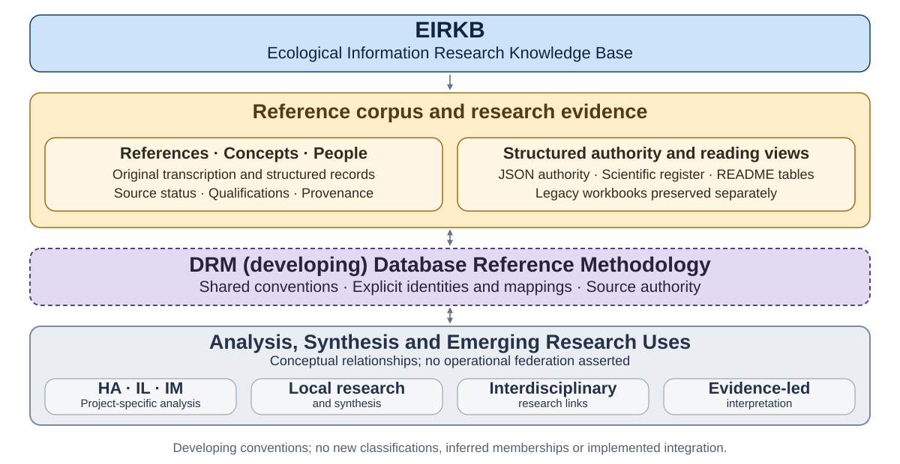

# Ecological Information Research Knowledge Base

[View full-size federation diagram](assets/diagrams/eirkb_federation.svg).

EIRKB collects references, concepts and people concerned with the history and theory of ecological information, supporting historical, intellectual and thematic analysis. Its GitHub repository provides the [scientific register](https://github.com/ecological-interaction/EIRKB/blob/main/EIRKB_Scientific_Reference_Register.md) containing the complete research tables, the [machine reference](https://github.com/ecological-interaction/EIRKB/blob/main/EIRKB_Machine_Reference.json) containing structured records and identifiers, and the [research protocol](https://github.com/ecological-interaction/EIRKB/blob/main/EIRKB_Research_Protocol.md) describing methods and governance.

## References

| ID | Primary category | Secondary branch | Author / institution | Year | Title / reference | Type | Key concept / contribution | Relevance to thesis | Source status | DOI / source URL |
| --- | --- | --- | --- | --- | --- | --- | --- | --- | --- | --- |
| R001 | Foundations of natural knowledge | Perception / biology | Aristotle | c. 350 BCE | De Anima (On the Soul) | Book | Perception, sensation, living beings | Deep historical root for theories of sensing and perception | Explicitly mentioned |  |
| R002 | Thermodynamics &amp; information | Entropy | Ludwig Boltzmann | 1870s | Statistical mechanics / entropy work | Research corpus | Entropy, probability, statistical description | Prehistory of mathematical information and uncertainty | Explicitly mentioned |  |
| R003 | Semiotics &amp; interpretation | Pragmatism / signs | Charles Sanders Peirce | 1860s–1910s | Collected writings on semiotics | Research corpus | Sign–object–interpretant; semiosis | Foundation for meaning, interpretation, biosemiotics | Explicitly mentioned |  |
| R004 | Perceptual worlds | Umwelt | Jakob von Uexküll | 1934 | A Foray into the Worlds of Animals and Humans | Book | Umwelt; species-specific perceptual worlds | Asks what counts as information for different organisms | Explicitly mentioned |  |
| R005 | Information theory | Communication | Claude E. Shannon | 1948 | A Mathematical Theory of Communication | Journal article | Information, entropy, channel, noise, redundancy | Separates measurable information from semantic meaning | Explicitly mentioned | https://doi.org/10.1002/j.1538-7305.1948.tb01338.x |
| R006 | Information theory | Communication | Claude E. Shannon &amp; Warren Weaver | 1949 | The Mathematical Theory of Communication | Book | Technical, semantic and effectiveness dimensions of communication | Useful distinction between signal transmission and meaning | Explicitly mentioned |  |
| R007 | Cybernetics | Feedback &amp; control | Norbert Wiener | 1948 | Cybernetics: Or Control and Communication in the Animal and the Machine | Book | Feedback, control, communication | Connects organisms and machines through feedback | Explicitly mentioned |  |
| R008 | Cybernetics | Regulation / variety | W. Ross Ashby | 1956 | An Introduction to Cybernetics | Book | Requisite variety, regulation, systems | Supports observability, regulation and decision frameworks | Explicitly mentioned |  |
| R009 | Cybernetics | Second-order cybernetics | Heinz von Foerster | 1970s–1980s | Writings on second-order cybernetics | Research corpus | Observer in the system; recursive observation | Supports move from objective observer to participant | Explicitly mentioned |  |
| R010 | Cybernetics &amp; ecology | Ecology of mind | Gregory Bateson | 1972 | Steps to an Ecology of Mind | Book | Difference, pattern, feedback, relationship, ecology of mind | Major hinge between cybernetics, ecology and relational information | Explicitly mentioned |  |
| R011 | Ecological psychology | Affordances | James J. Gibson | 1979 | The Ecological Approach to Visual Perception | Book | Affordances; direct perception; information pickup | Key bridge from ecological information to productive affordance | Explicitly mentioned |  |
| R012 | Autopoiesis &amp; enaction | Cognition | Humberto Maturana &amp; Francisco Varela | 1980 | Autopoiesis and Cognition: The Realization of the Living | Book | Autopoiesis, cognition, organism–environment relation | Supports relational and participatory accounts of knowing | Explicitly mentioned |  |
| R013 | Autopoiesis &amp; enaction | Embodied cognition | Francisco Varela, Evan Thompson &amp; Eleanor Rosch | 1991 | The Embodied Mind | Book | Enaction, embodied cognition | Extends perception from representation toward active engagement | Concept implied; anchor work added |  |
| R014 | Biosemiotics | Zoosemiotics | Thomas A. Sebeok | 1972 | Perspectives in Zoosemiotics | Monograph | Animal communication, zoosemiotics | Extends semiotic analysis beyond human language | Explicitly mentioned |  |
| R015 | Biosemiotics | Biological meaning | Jesper Hoffmeyer | 1996 | Signs of Meaning in the Universe | Book | Biosemiotics, biological sign processes | Connects semiosis to living systems | Explicitly mentioned |  |
| R016 | Ecosemiotics | Environmental meaning | Timo Maran &amp; Kalevi Kull | 2014 | Ecosemiotics: main principles and current developments | Journal article | Ecosemiotics; environmental perception and transformation | Connects semiotics, ecology and environmental interpretation | Explicitly discussed | https://doi.org/10.1111/geob.12035 |
| R017 | Systems ecology | Ecosystems | Eugene P. Odum | 1953 | Fundamentals of Ecology | Book | Ecosystem ecology, energy flows | Major foundation for systems-level ecological thinking | Explicitly mentioned |  |
| R018 | Systems ecology | Energy / information | Howard T. Odum | 1971 | Environment, Power, and Society | Book | Energy systems, feedback, systems diagrams | Treats ecosystems as coupled flows of energy, material and information | Explicitly mentioned |  |
| R019 | Systems ecology | Emergy / information | Howard T. Odum | 1996 | Environmental Accounting: Emergy and Environmental Decision Making | Book | Emergy, systems accounting, decision-making | Precedent for translating ecological systems into decision frameworks | Author/concepts explicit; anchor work added |  |
| R020 | Ecological information theory | Food webs | Robert H. MacArthur | 1955 | Fluctuations of Animal Populations and a Measure of Community Stability | Journal article | Information-theoretic ideas in ecology; stability | Early bridge between information theory and ecology | Explicitly mentioned |  |
| R021 | Ecological networks | Information theory | Robert E. Ulanowicz | 1986 | Growth and Development: Ecosystems Phenomenology | Book | Network analysis, ascendency, ecosystem information | Develops information-theoretic systems ecology | Explicitly mentioned |  |
| R022 | Complexity | Dissipative systems | Ilya Prigogine | 1977 | Self-Organization in Nonequilibrium Systems | Book | Dissipative structures, self-organisation | Supports non-equilibrium ecological and industrial systems thinking | Explicitly mentioned |  |
| R023 | Complexity | Self-organisation | Stuart A. Kauffman | 1993 | The Origins of Order | Book | Self-organisation, complexity, adaptive systems | Useful for emergence and generative possibility | Explicitly mentioned |  |
| R024 | Resilience | Ecological systems | C. S. Holling | 1973 | Resilience and Stability of Ecological Systems | Journal article | Resilience, stability, regime change | Foundation for adaptive, changing territories | Explicitly mentioned | https://doi.org/10.1146/annurev.es.04.110173.000245 |
| R025 | Regime shifts | Early warning | Marten Scheffer et al. | 2009 | Early-warning signals for critical transitions | Journal article | Critical slowing down; early-warning indicators | Connects signals/indicators to changing system states | Explicitly mentioned concept/author | https://doi.org/10.1038/nature08227 |
| R026 | Earth / biosphere | Biogeography | Alexander von Humboldt | 1807 | Essay on the Geography of Plants | Book | Interconnected nature, plant geography | Early relational and spatial conception of environment | Explicitly mentioned |  |
| R027 | Earth / biosphere | Biosphere | Vladimir I. Vernadsky | 1926 | The Biosphere | Book | Biosphere, life as geological force | Precursor to Earth-system and Critical Zone thinking | Explicitly mentioned |  |
| R028 | Gaia / Earth systems | Planetary feedback | James Lovelock &amp; Lynn Margulis | 1974 | Atmospheric homeostasis by and for the biosphere: the Gaia hypothesis | Journal article | Planetary feedback, organism–environment coupling | Scales ecological feedback to the planetary level | Explicitly mentioned | https://doi.org/10.3402/tellusa.v26i1-2.9731 |
| R029 | Earth systems | Tipping dynamics | Timothy M. Lenton | 2000s–present | Earth-system feedback and tipping-point research | Research corpus | Tipping elements, planetary feedbacks | Connects observability and indicators to planetary transitions | Explicitly mentioned |  |
| R030 | Molecular information | Evolution | Charles Darwin | 1859 | On the Origin of Species | Book | Evolution, selection, adaptation | Historical root for biological information without genetic mechanism | Explicitly mentioned |  |
| R031 | Molecular information | Inheritance | Gregor Mendel | 1866 | Experiments on Plant Hybridization | Journal article | Inheritance, traits | Root of genetics and biological information lineage | Explicitly mentioned |  |
| R032 | Molecular information | DNA structure | James Watson &amp; Francis Crick | 1953 | Molecular Structure of Nucleic Acids | Journal article | DNA double helix | Landmark in molecular information framing | Explicitly mentioned | https://doi.org/10.1038/171737a0 |
| R033 | Molecular information | DNA structure | Rosalind Franklin &amp; Raymond Gosling | 1953 | Molecular Configuration in Sodium Thymonucleate | Journal article | X-ray evidence for DNA structure | Essential experimental contribution to molecular information history | Franklin explicitly mentioned | https://doi.org/10.1038/171740a0 |
| R034 | Synthetic biology &amp; genomics | Reading/writing biology | George Church | 2000s–present | Genomics, genome synthesis and synthetic biology research corpus | Research corpus | Sequencing, synthesis, biological engineering | Represents shift from reading biological information to writing it | Explicitly mentioned | https://arep.med.harvard.edu/ |
| R035 | Systems biology | Multi-level causation | Denis Noble | 2006 | The Music of Life: Biology Beyond Genes | Book | Systems biology, multi-level causation | Counterweight to gene-centric information metaphors | Explicitly mentioned |  |
| R036 | Multispecies studies | More-than-human anthropology | Eduardo Kohn | 2013 | How Forests Think | Book | Nonhuman semiosis, representation | Extends meaning and interpretation beyond humans | Explicitly mentioned |  |
| R037 | Multispecies studies | Sympoiesis | Donna Haraway | 2016 | Staying with the Trouble | Book | Making-with, multispecies relations, situated knowledge | Supports participatory and more-than-human framing | Explicitly mentioned |  |
| R038 | Multispecies studies | Animal epistemology | Vinciane Despret | 2016 | What Would Animals Say If We Asked the Right Questions? | Book | Questions, experimental arrangements, animal agency | Shows observation as interaction shaping what becomes knowable | Explicitly mentioned |  |
| R039 | Multispecies studies | Assemblages | Anna Lowenhaupt Tsing | 2015 | The Mushroom at the End of the World | Book | Multispecies assemblages, precarity | Useful for situated economies and more-than-human production | Explicitly mentioned |  |
| R040 | Multispecies studies | Emergent ecologies | Eben Kirksey | 2015 | Emergent Ecologies | Book | Multispecies worlds, emergent relations | Supports nonhuman participation in changing environments | Explicitly mentioned |  |
| R041 | Plant philosophy | Plant worlds | Emanuele Coccia | 2016 | The Life of Plants | Book | Plant life, atmosphere, immersion | Philosophical expansion of organism–environment relations | Explicitly mentioned |  |
| R042 | Plant signalling | Plant cognition | Monica Gagliano | 2010s–present | Plant learning and signalling research corpus | Research corpus | Plant signalling, learning claims | Relevant to expanded sensory/signalling ecologies; requires critical reading | Explicitly mentioned |  |
| R043 | Animal cognition | Cephalopod minds | Peter Godfrey-Smith | 2016 | Other Minds | Book | Evolution of cognition, cephalopod perception | Supports comparative sensory worlds and cognition | Explicitly mentioned |  |
| R044 | Animal cognition | Comparative cognition | Frans de Waal | 2016 | Are We Smart Enough to Know How Smart Animals Are? | Book | Animal cognition, anthropocentric bias | Challenges human-centred interpretation of animal capacities | Explicitly mentioned |  |
| R045 | Animal communication | Political / linguistic relations | Eva Meijer | 2019 | When Animals Speak | Book | Animal communication, interspecies relations | Relevant to signals, interpretation and more-than-human participation | Explicitly mentioned |  |
| R046 | Nonhuman intelligence | Technology &amp; ecology | James Bridle | 2022 | Ways of Being | Book | Nonhuman intelligence, technology, ecology | Contemporary synthesis of ecological and technological intelligence | Explicitly mentioned |  |
| R047 | Environmental computation | Sensing | Jennifer Gabrys | 2016 | Program Earth: Environmental Sensing Technology and the Making of a Computational Planet | Book | Environmental sensing, computational environments | Central critique of sensors as active participants in producing environments as data | Explicitly mentioned |  |
| R048 | Media &amp; computation | Embodiment | N. Katherine Hayles | 1999 | How We Became Posthuman | Book | Information, embodiment, computation | Challenges disembodied conceptions of information | Explicitly mentioned |  |
| R049 | Media archaeology | Material infrastructures | Jussi Parikka | 2015 | A Geology of Media | Book | Materiality of media, geology, extraction | Links computation to material and geological infrastructures | Explicitly mentioned |  |
| R050 | Infrastructure studies | Urban / media knowledge | Shannon Mattern | 2021 | A City Is Not a Computer | Book | Urban knowledge, infrastructure, limits of computational metaphors | Useful critique of making place computational | Explicitly mentioned |  |
| R051 | Knowledge infrastructures | Climate science | Paul N. Edwards | 2010 | A Vast Machine | Book | Climate models, data, knowledge infrastructure | Major precedent for planetary observation as infrastructure | Explicitly mentioned |  |
| R052 | Satellite / media studies | Planetary infrastructures | Lisa Parks | 2005 | Cultures in Orbit | Book | Satellites, media, orbital infrastructure | Connects Earth observation to sociotechnical infrastructure | Explicitly mentioned |  |
| R053 | Planetary computation | Computation / governance | Benjamin H. Bratton | 2015 | The Stack | Book | Planetary-scale computation | Useful for digital ecological infrastructure at planetary scale | Explicitly mentioned |  |
| R054 | Philosophy of technology | Cosmotechnics | Yuk Hui | 2016 | On the Existence of Digital Objects | Book | Digital objects, milieu, relations | Connects digital infrastructures to relational technical environments | Explicitly mentioned |  |
| R055 | Philosophy of technology | Individuation / milieu | Gilbert Simondon | 1958 / Eng. 2020 | Individuation in Light of Notions of Form and Information | Book | Individuation, information, milieu | Deep theoretical bridge among information, organisms and technical systems | Explicitly mentioned |  |
| R056 | Environmental philosophy | Hyperobjects | Timothy Morton | 2013 | Hyperobjects | Book | Distributed phenomena across scales | Frames phenomena such as climate change as exceeding direct perception | Explicitly mentioned |  |
| R057 | Environmental philosophy | Ecology / nature | Timothy Morton | 2007 | Ecology Without Nature | Book | Critique of 'nature' as aesthetic/ontological category | Useful critique of environmental representation | Explicitly mentioned |  |
| R058 | Environmental philosophy | Ecological thought | Timothy Morton | 2010 | The Ecological Thought | Book | Interdependence, ecological thinking | Broad relational environmental philosophy | Explicitly mentioned |  |
| R059 | Environmental philosophy | Dark ecology | Timothy Morton | 2016 | Dark Ecology | Book | Ecological coexistence, scale, entanglement | Extends critique of conventional environmentalism | Explicitly mentioned |  |
| R060 | Environmental philosophy | Being ecological | Timothy Morton | 2018 | Being Ecological | Book | Everyday ecological existence | Accessible extension of ecological philosophy | Explicitly mentioned |  |
| R061 | STS / Critical Zones | Terrestrial politics | Bruno Latour &amp; Peter Weibel (eds.) | 2020 | Critical Zones: The Science and Politics of Landing on Earth | Edited volume / exhibition | Critical Zones, terrestriality, interdisciplinary observation | Extends Critical Zone from Earth science toward inhabited/political territory | Explicitly mentioned |  |
| R062 | STS / Gaia | Terrestrial politics | Bruno Latour | 2017 | Facing Gaia | Book | Gaia, politics, terrestrial condition | Connects Earth systems with politics and knowledge practices | Latour/Gaia explicitly discussed; anchor work added |  |
| R063 | Philosophy of science | Ecology / practice | Isabelle Stengers | 2005 | The Cosmopolitical Proposal | Essay | Cosmopolitics, situated knowledge, plurality | Supports caution about universalising knowledge and intervention | Explicitly mentioned |  |
| R064 | Critical Zone Science | Earth surface processes | National Research Council | 2001 | Basic Research Opportunities in Earth Science | Report | Critical Zone as Earth-science research frontier | Institutional precursor to formal Critical Zone research programs | Critical Zone origin discussed; anchor added | https://doi.org/10.17226/9981 |
| R065 | Critical Zone Science | Critical Zone exploration | Susan L. Brantley et al. | 2007 | Frontiers in Exploration of the Critical Zone | Report | Coupled rock–soil–water–life processes | Foundational Critical Zone research agenda | Explicitly mentioned |  |
| R066 | Critical Zone Science | Weathering / landscape | Suzanne P. Anderson | 2000s–present | Critical Zone geomorphology and weathering research corpus | Research corpus | Weathering, erosion, landscape evolution | Key Critical Zone scientist named in discussion | Explicitly mentioned |  |
| R067 | Critical Zone Science | Hydropedology | Henry Lin | 2000s–present | Hydropedology and Critical Zone research corpus | Research corpus | Soil architecture, water, Critical Zone processes | Key Critical Zone scientist named in discussion | Explicitly mentioned |  |
| R068 | Ecological indicators | Indicator species | Frederic E. Clements | 1920 | Plant Indicators | Book | Plants as indicators of environmental conditions | Historical root for ecological indicator thinking | Explicitly mentioned |  |
| R069 | Ecological indicators | Wildlife / monitoring | Peter B. Landres, Jared Verner &amp; James W. Thomas | 1988 | Ecological Uses of Vertebrate Indicator Species: A Critique | Journal article | Indicator species, validity and limitations | Important critique of indicator assumptions | Explicitly mentioned | https://doi.org/10.1111/j.1523-1739.1988.tb00195.x |
| R070 | Ecological indicators | Indicator design | Virginia H. Dale &amp; Suzanne C. Beyeler | 2001 | Challenges in the development and use of ecological indicators | Journal article | Indicator selection, ecological relevance | Directly supports rigorous indicator design | Explicitly mentioned | https://doi.org/10.1016/S1470-160X(01)00003-6 |
| R071 | Ecological indicators | Ecosystem health | David J. Rapport | 1990s | Ecosystem health / ecological indicator research corpus | Research corpus | Ecosystem health, stress, indicators | Supports indicator-to-condition inference | Explicitly mentioned |  |
| R072 | Ecological economics | Ecosystem valuation | Robert Costanza et al. | 1997 | The value of the world's ecosystem services and natural capital | Journal article | Ecosystem services, natural capital | Relevant to ecological-economic valuation, with important normative caveats | Explicitly mentioned | https://doi.org/10.1038/387253a0 |
| R073 | Ecological indicators | National assessment | National Research Council | 2000 | Ecological Indicators for the Nation | Report | Indicator foundations and selection frameworks | Systematic reference for indicator design and assessment | Added to complete indicator branch | https://doi.org/10.17226/9720 |
| R074 | Biodiversity observation | Essential variables | Henrique M. Pereira et al. | 2013 | Essential Biodiversity Variables | Journal article | Harmonised biodiversity observation variables | Links ecological indicators to global observation systems | Explicitly mentioned | https://doi.org/10.1126/science.1229931 |
| R075 | Adaptive monitoring | Monitoring design | David B. Lindenmayer &amp; Gene E. Likens | 2010 | The science and application of ecological monitoring | Journal article / related book corpus | Adaptive monitoring, question-driven monitoring | Supports technology-after-question monitoring logic | Explicitly mentioned | https://doi.org/10.1016/j.biocon.2010.02.013 |
| R076 | Adaptive management | Decision-focused monitoring | James E. Lyons, Michael C. Runge, Harold P. Laskowski &amp; William L. Kendall | 2008 | Monitoring in the Context of Structured Decision-Making and Adaptive Management | Journal article | Monitoring linked to decisions and uncertainty | Strong precedent for observation designed around decisions rather than data accumulation | Added to strengthen explicit thesis logic | https://doi.org/10.2193/2008-141 |
| R077 | Appropriate technology | Economics / scale | E. F. Schumacher | 1973 | Small Is Beautiful | Book | Appropriate technology, scale, decentralisation | Historical anchor for technology choice fitted to place and society | Explicitly mentioned |  |
| R078 | Design with environment | Suitability analysis | Ian L. McHarg | 1969 | Design with Nature | Book | Overlay mapping, ecological suitability analysis | Major precedent for translating environmental information into design proposition | Explicitly mentioned |  |
| R079 | Industrial ecology | Industrial metabolism | Robert Frosch &amp; Nicholas Gallopoulos | 1989 | Strategies for Manufacturing | Article | Industrial ecosystems, industrial metabolism | Historical anchor for industry as material/energy system | Industrial ecology explicit; anchor work added |  |
| R080 | Industrial ecology | Industrial metabolism | Robert U. Ayres | 1989 | Industrial Metabolism | Chapter / research program | Material and energy flows through economies | Supports metabolic analysis of productive infrastructure | Industrial ecology explicit; anchor work added |  |
| R081 | Regenerative design | Regenerative development | John Tillman Lyle | 1994 | Regenerative Design for Sustainable Development | Book | Regenerative systems and design | Direct precedent for production intended to renew ecological systems | Regenerative design explicit; anchor work added |  |
| R082 | Bioregionalism | Place / inhabitation | Peter Berg &amp; Raymond Dasmann | 1977 | Reinhabiting California | Essay | Bioregionalism, reinhabitation | Precedent for ecological-cultural territorial units | Bioregionalism explicit; anchor work added |  |
| R083 | Political ecology | Power / environment | Piers Blaikie &amp; Harold Brookfield | 1987 | Land Degradation and Society | Book | Political ecology, land degradation, power | Prevents ecological/technological choice being reduced to biophysical optimisation | Political ecology explicit; anchor work added |  |
| R084 | Telecoupling | Distant dependencies | Jianguo Liu et al. | 2013 | Framing Sustainability in a Telecoupled World | Journal article | Telecoupling, distant socioeconomic/environmental interactions | Tests the limits of localism and bioregional self-containment | Telecoupling explicit; anchor work added | https://doi.org/10.5751/ES-05873-180226 |
| R085 | Citizen science | Participatory monitoring | Rick Bonney et al. | 2009 | Citizen Science: A Developing Tool for Expanding Science Knowledge and Scientific Literacy | Journal article | Citizen science, participation | Supports inhabitants as contributors to ecological knowledge infrastructure | Citizen science explicit; anchor work added | https://doi.org/10.1641/0006-3568-59.11.977 |
| R086 | Open source / maker practice | Commons-based production | Yochai Benkler | 2006 | The Wealth of Networks | Book | Commons-based peer production | Useful for distributed/open technological infrastructures | Maker/open-source branch explicit; anchor work added |  |
| R087 | Planetary observation | Earth observation program | NASA | 2020s | Earth System Observatory | Research program | Integrated satellite observation of coupled Earth systems | State-of-the-art planetary observation context raised in discussion | Explicitly mentioned | https://science.nasa.gov/earth-science/earth-system-observatory/ |
| R088 | Planetary observation | Forest structure / LiDAR | NASA / University of Maryland | 2018–present | GEDI — Global Ecosystem Dynamics Investigation | Mission / research program | Spaceborne LiDAR; 3D forest structure | Example of signals becoming structural ecological inference at planetary scale | Explicitly mentioned | https://gedi.umd.edu/ |
| R089 | Planetary observation | Biodiversity remote sensing | NASA / University of Cape Town and partners | 2023–present | BioSCape | Research campaign | Imaging spectroscopy, LiDAR, thermal and biodiversity observations | State-of-the-art integration of remote sensing and field biodiversity | Explicitly mentioned | https://www.bioscape.io/ |
| R090 | Biodiversity observation | Global observation network | GEO BON | 2008–present | Group on Earth Observations Biodiversity Observation Network | Research network | Coordinated biodiversity observation; EBVs | Institutional context for essential-variable and planetary biodiversity observation | Discussed via EBV lineage | https://geobon.org/ |
| R091 | Social–ecological systems | Commons / governance | Elinor Ostrom | 2009 | A General Framework for Analyzing Sustainability of Social-Ecological Systems | Journal article | SES framework, governance, resources, users | Strong framework for coupling ecology, economy, institutions and decision-making | Field explicit; anchor work added | https://doi.org/10.1126/science.1172133 |
| R092 | Ecological economics | Economy / ecology | Herman E. Daly | 1996 | Beyond Growth | Book | Steady-state economics, ecological limits | Relevant to evaluating economic production within ecological constraints | Economic/ecological production thread; anchor added |  |
| R093 | Design research | Research through design | Christopher Frayling | 1993 | Research in Art and Design | Paper | Research into/through/for art and design | Supports designed infrastructure as method and doctoral output | Design research explicit; anchor work added |  |
| R094 | Design research | Research through design | John Zimmerman, Jodi Forlizzi &amp; Shelley Evenson | 2007 | Research through design as a method for interaction design research in HCI | Conference paper | Research through design, artefact as inquiry | Useful methodological precedent for generative infrastructure | Design research explicit; anchor work added | https://doi.org/10.1145/1240624.1240704 |
| R095 | Cybernetics | Viable System Model | Stafford Beer | 1995 | Brain of the Firm, 2nd edition. Wiley, Classic Beer Series. ISBN 9780471948391 | Book (verified 1995 issue) | Organizational viability, distributed regulation and recursive organization. | Supports governance of distributed ecological infrastructures. This record identifies the verified edition, rather than assigning its details to the 1972 first edition. | V1 omission: thinker explicitly named. Bibliographic source checked 2026-09-30. | https://uat.store.wiley.com/en-us/brain-of-the-firm-2nd-edition-p-9780471948391 |
| R096 | Systems ecology | Energetics / mathematical biology | Alfred J. Lotka | 1925 | Elements of Physical Biology. Williams &amp; Wilkins | Book | Physical and mathematical treatment of biological systems and population interactions. | Historical precursor to ecosystem energetics and systems ecology. | V1 omission: thinker explicitly named. Bibliographic source checked 2026-09-30. | https://archive.org/details/elementsofphysic0000alfr |
| R097 | Systems ecology | Trophic dynamics | Raymond L. Lindeman | 1942 | The Trophic-Dynamic Aspect of Ecology. Ecology 23(4), 399–417 | Journal article | Energy transfers and trophic organization of ecosystems. | Connects ecological production and energy-flow accounting. | V1 omission: thinker explicitly named. Bibliographic source checked 2026-09-30. | https://doi.org/10.2307/1930126 |
| R098 | Ecological philosophy | Rhizome / assemblage | Gilles Deleuze &amp; Félix Guattari | 1987 | A Thousand Plateaus: Capitalism and Schizophrenia. Translated by Brian Massumi. University of Minnesota Press | Book (English translation) | Rhizomes, assemblages, becoming and relational organization. | Philosophical resource for non-linear knowledge structures; conceptual connection, not evidence of direct historical influence. French original: 1980. | V1 omission: thinkers explicitly named. Bibliographic source checked 2026-09-30. | https://www.upress.umn.edu/9780816614028/a-thousand-plateaus/ |
| R099 | Biodiversity observation | European observation infrastructure | EuropaBON consortium / European Commission | 2020–2024 | Europa Biodiversity Observation Network: integrating data streams to support policy. Horizon 2020 grant 101003553 | Research project | Integration of biodiversity data streams and observation needs for European policy. | Links monitoring design, EBVs, ecosystem-service variables and policy demand. | V1 omission: programme explicitly named. Bibliographic source checked 2026-09-30. | https://cordis.europa.eu/project/id/101003553 |
| R100 | Industrial ecology | Genealogy / material balances | Robert U. Ayres &amp; Allen V. Kneese | 1969 | Production, Consumption, and Externalities. American Economic Review 59(3), 282–297 | Journal article | Material balances connect production, consumption and residuals. | Foundational physical accounting of economic activity; complements R080. | Explicitly identified after V1. Bibliographic source checked 2026-09-30. | https://ideas.repec.org/a/aea/aecrev/v59y1969i3p282-97.html |
| R101 | Industrial ecology | Disciplinary consolidation / design for environment | Thomas E. Graedel &amp; Braden R. Allenby | 1995 | Industrial Ecology. Prentice Hall. ISBN 9780131252387 | Book | Industrial systems, life cycles, materials, energy and product design. | Major disciplinary anchor and source for design-for-environment methods. | Explicitly identified after V1. Bibliographic source checked 2026-09-30. | https://jie.yale.edu/industrial-ecology |
| R102 | Industrial ecology | Societal metabolism / genealogy | Marina Fischer-Kowalski | 1998 | Society’s Metabolism: The Intellectual History of Materials Flow Analysis, Part I, 1860–1970. Journal of Industrial Ecology 2(1), 61–78 | Journal article | Historical development of material and energetic accounts of society–nature relations. | Extends industrial metabolism to the biophysical basis of social systems. | Thinker and genealogy explicitly identified after V1. Bibliographic source checked 2026-09-30. | https://doi.org/10.1162/jiec.1998.2.1.61 |
| R103 | Industrial ecology | Socioeconomic metabolism | Stefan Pauliuk &amp; Edgar G. Hertwich | 2015 | Socioeconomic metabolism as paradigm for studying the biophysical basis of human societies. Ecological Economics 119, 83–93 | Journal article | Socioeconomic metabolism as a shared framework for physical stocks, flows and integrated models. | Connects ecological capacity, infrastructure and production. The article is by Pauliuk and Hertwich, not Fischer-Kowalski. | Study described after V1; authors recovered during verification. Bibliographic source checked 2026-09-30. | https://doi.org/10.1016/j.ecolecon.2015.08.012 |
| R104 | Industrial ecology | Industrial symbiosis / emergence | John Ehrenfeld &amp; Nicholas Gertler | 1997 | Industrial Ecology in Practice: The Evolution of Interdependence at Kalundborg. Journal of Industrial Ecology 1(1), 67–79 | Journal article | Evolution of exchanges among firms in Kalundborg. | Shows how productive relationships emerge through situated decisions. | Explicitly identified after V1. Bibliographic source checked 2026-09-30. | https://doi.org/10.1162/jiec.1997.1.1.67 |
| R105 | Industrial ecology | Industrial symbiosis / eco-industrial parks | Marian R. Chertow | 2007 | “Uncovering” Industrial Symbiosis. Journal of Industrial Ecology 11(1), 11–30 | Journal article | Recognizing and developing existing resource-sharing relationships. | Supports discovering productive affordances rather than assuming exchanges can be designed from scratch. | Explicitly identified after V1. Bibliographic source checked 2026-09-30. | https://doi.org/10.1162/jiec.2007.1110 |
| R106 | Industrial ecology | Industrial symbiosis / territorial example | Kalundborg Symbiosis | n.d. | Kalundborg Symbiosis: industrial partnerships and resource exchanges | Programme website | Industrial exchanges of water, energy and materials. | Place-based case alongside Ehrenfeld and Chertow; membership is time dependent. | Case explicitly named after V1. Bibliographic source checked 2026-09-30. | https://www.symbiosis.dk/en/ |
| R107 | Industrial ecology | Economy-wide material flow accounting | Eurostat | 2018 | Economy-wide material flow accounts handbook. Publications Office of the European Union | Statistical handbook | Definitions and mass-balance accounting of extraction, trade, outputs and accumulation. | Operational method for territorial resource accounting and resource efficiency. | Method explicitly discussed after V1. Bibliographic source checked 2026-09-30. | https://doi.org/10.2785/158567 |
| R108 | Industrial ecology | Material / substance flow analysis | Paul H. Brunner &amp; Helmut Rechberger | 2004 | Practical Handbook of Material Flow Analysis. Lewis Publishers / CRC Press | Methods handbook | System boundaries, processes, stocks and flows of materials and substances. | Supports consistent balances for biomass, nutrients, water and contaminants. | Supporting publication selected for V2. Bibliographic source checked 2026-09-30. | https://www.tuwien.at/index.php?eID=dumpFile&amp;f=117635&amp;t=f&amp;token=39fedf8e713b0600ecedc201a4045034b782add3 |
| R109 | Industrial ecology | Life-cycle assessment | International Organization for Standardization | 2006 | ISO 14040:2006. Environmental management — Life cycle assessment — Principles and framework | Standard | Goal and scope, inventory, impact assessment and interpretation. | Prevents narrow claims about regenerative technologies that omit upstream and downstream burdens. | Supporting publication selected for V2. Bibliographic source checked 2026-09-30. | https://www.iso.org/standard/37456.html |
| R110 | Industrial ecology | Input–output analysis / energy flows | Ronald E. Miller &amp; Peter D. Blair | 2009 | Input–Output Analysis: Foundations and Extensions, 2nd edition. Cambridge University Press | Book | Interindustry dependencies, regional analysis and environmental and energy extensions. | Traces indirect resource demand and distant supply-chain burdens. | Supporting publication selected for V2. Bibliographic source checked 2026-09-30. | https://www.cambridge.org/core/books/inputoutput-analysis/69827DA658E766CD1E17B1A47BA2B9C3 |
| R111 | Industrial ecology | Urban metabolism | Abel Wolman | 1965 | The Metabolism of Cities. Scientific American 213(3), 178–190 | Journal article | Urban water, resource inputs and waste outputs. | Historical bridge from cities to territorial metabolic analysis. | Supporting publication selected for V2. Bibliographic source checked 2026-09-30. | https://doi.org/10.1038/scientificamerican0965-178 |
| R112 | Industrial ecology | Material stocks and flows | Fridolin Krausmann et al. | 2017 | Global socioeconomic material stocks rise 23-fold over the 20th century and require half of annual resource use. PNAS 114(8), 1880–1885 | Journal article | Infrastructure stocks drive resource inputs, maintenance and waste. | Makes productive infrastructure measurable as physical stocks. | Supporting publication selected for V2. Bibliographic source checked 2026-09-30. | https://doi.org/10.1073/pnas.1613773114 |
| R113 | Industrial ecology | Critical materials | Thomas E. Graedel, E. M. Harper, N. T. Nassar, Philip Nuss &amp; Barbara K. Reck | 2015 | Criticality of metals and metalloids. PNAS 112(14), 4257–4262 | Journal article | Supply risk, environmental implications and vulnerability to supply restrictions. | Tests material dependencies of proposed ecological technologies. | Supporting publication selected for V2. Bibliographic source checked 2026-09-30. | https://doi.org/10.1073/pnas.1500415112 |
| R114 | Industrial ecology | Extended producer responsibility | OECD | 2016 | Extended Producer Responsibility: Updated Guidance for Efficient Waste Management. OECD Publishing | Policy / methods report | Producer responsibility for products and post-consumer management. | Connects product design, institutions and end-of-life material flows. | Supporting publication selected for V2. Bibliographic source checked 2026-09-30. | https://doi.org/10.1787/9789264256385-en |
| R115 | Industrial ecology | Circular economy | Ellen MacArthur Foundation | n.d. | The Circular Economy: definition and model overview | Framework website | Eliminating waste, circulating products and materials, and regenerating nature. | Useful design framework; circularity alone does not establish net ecological benefit. | Supporting publication selected for V2. Bibliographic source checked 2026-09-30. | https://www.ellenmacarthurfoundation.org/topics/circular-economy-introduction/overview |
| R116 | Limits, boundaries &amp; ecological capacity | Carrying-capacity genealogy | Thomas Robert Malthus | 1798 | An Essay on the Principle of Population, 1st edition. J. Johnson | Book | Population growth and constraints on subsistence. | Historical ancestor of population/resource debates, not a fixed contemporary measure of human capacity. | Historical thinker explicitly invoked after V1. Bibliographic source checked 2026-09-30. | https://www.econlib.org/library/Malthus/malPop.html |
| R117 | Limits, boundaries &amp; ecological capacity | Carrying capacity / critique | Irmi Seidl &amp; Clem A. Tisdell | 1999 | Carrying capacity reconsidered: from Malthus’ population theory to cultural carrying capacity. Ecological Economics 31(3), 395–408 | Journal article | Historical and normative dimensions of carrying-capacity concepts. | Makes human capacity conditional on consumption, technology, culture and value choices. | Explicitly identified after V1. Bibliographic source checked 2026-09-30. | https://doi.org/10.1016/S0921-8009(99)00063-4 |
| R118 | Limits, boundaries &amp; ecological capacity | Ecological footprint / appropriated capacity | William E. Rees | 1992 | Ecological footprints and appropriated carrying capacity: what urban economics leaves out. Environment and Urbanization 4(2), 121–130 | Journal article | Urban resource demand expressed through appropriated ecological area. | Connects local economic activity to supporting ecosystems beyond territorial borders. | Explicitly identified after V1. Bibliographic source checked 2026-09-30. | https://doi.org/10.1177/095624789200400212 |
| R119 | Limits, boundaries &amp; ecological capacity | Ecological footprint / biocapacity | Mathis Wackernagel &amp; William E. Rees | 1996 | Our Ecological Footprint: Reducing Human Impact on the Earth. New Society Publishers | Book | Area-based accounting of human demand on productive ecosystems. | Foundational account of the footprint approach; use alongside disaggregated ecological measures. | Explicitly identified after V1. Bibliographic source checked 2026-09-30. | https://faculty.washington.edu/stevehar/footprint.pdf |
| R120 | Limits, boundaries &amp; ecological capacity | Footprint accounting / biocapacity | Global Footprint Network | n.d. | Ecological Footprint: accounting framework and definitions | Framework website | Footprint demand and biocapacity supply expressed in global hectares. | Distinguishes territorial deficits, reserves and global overshoot; does not measure every ecological impact. | Framework explicitly discussed after V1. Bibliographic source checked 2026-09-30. | https://footprintnetwork.org/our-work/ecological-footprint/ |
| R121 | Limits, boundaries &amp; ecological capacity | Overshoot / public communication | Global Footprint Network | 2020 | Earth Overshoot Day 2020: Calculation Research Report | Methods report | Converts biocapacity-to-footprint ratio to a calendar date, with nowcasting. | Demonstrates how a capacity account becomes a communication indicator; historical report, not a current overshoot date. | Supporting publication selected for V2. Bibliographic source checked 2026-09-30. | https://www.overshootday.org/content/uploads/2020/06/Earth-Overshoot-Day-2020-Calculation-Research-Report.pdf |
| R122 | Ecological economics | Footprint critique / spatial sustainability | Jeroen C. J. M. van den Bergh &amp; Harmen Verbruggen | 1999 | Spatial sustainability, trade and indicators: an evaluation of the ‘ecological footprint’. Ecological Economics 29(1), 61–72 | Journal article | Critique of aggregation, land-equivalence, trade and regional sustainability. | Protects place-based analysis from over-reliance on one footprint score. | Critique described after V1; citation identified in verification. Bibliographic source checked 2026-09-30. | https://doi.org/10.1016/S0921-8009(99)00032-4 |
| R123 | Ecological economics | Footprint critique / policy | Jeroen C. J. M. van den Bergh &amp; Fabio Grazi | 2014 | Ecological Footprint Policy? Land Use as an Environmental Indicator. Journal of Industrial Ecology 18(1), 10–19 | Journal article | Critical assessment of footprint accounting for environmental policy. | Supports explicit indicator limitations and comparison with other measures. | Critique described after V1; citation identified in verification. Bibliographic source checked 2026-09-30. | https://doi.org/10.1111/jiec.12045 |
| R124 | Limits, boundaries &amp; ecological capacity | Footprint methodology / limitations | Global Footprint Network | n.d. | Limitations and Criticism of Ecological Footprint accounting | Methods website | Scope and limitations from the framework’s custodians. | Read with independent critiques; footprint is not a complete sustainability assessment. | Source type explicitly discussed after V1. Bibliographic source checked 2026-09-30. | https://footprintnetwork.org/our-work/ecological-footprint/limitations-and-criticisms/ |
| R125 | Ecological economics | Thermodynamics / economic limits | Nicholas Georgescu-Roegen | 1971 | The Entropy Law and the Economic Process. Harvard University Press | Book | Irreversibility and biophysical constraints in economic processes. | Genealogical link between thermodynamics, production and ecological economics. | Thinker explicitly named after V1. Bibliographic source checked 2026-09-30. | https://doi.org/10.4159/harvard.9780674281653 |
| R126 | Ecological economics | Doughnut / social and ecological limits | Kate Raworth | 2012 | A Safe and Just Space for Humanity: Can we live within the doughnut? Oxfam Discussion Paper | Framework / report | Social foundations and an ecological ceiling. | Places social needs alongside ecological constraints rather than equating minimum impact with desirable development. | Supporting publication selected for V2. Bibliographic source checked 2026-09-30. | https://www.oxfam.org/en/research/safe-and-just-space-humanity |
| R127 | Limits, boundaries &amp; ecological capacity | System dynamics / overshoot | Donella H. Meadows, Dennis L. Meadows, Jørgen Randers &amp; William W. Behrens III | 1972 | The Limits to Growth: A Report for the Club of Rome’s Project on the Predicament of Mankind. Universe Books | Book / modelling study | Interacting stocks, growth, delays and overshoot scenarios. | Supporting anchor for limits and overshoot; scenarios should not be presented as unconditional predictions. | Supporting publication selected for V2. Bibliographic source checked 2026-09-30. | https://collections.dartmouth.edu/archive/text/meadows/diplomatic/meadows_ltg-diplomatic.html |
| R128 | Limits, boundaries &amp; ecological capacity | Planetary Boundaries / safe operating space | Johan Rockström et al. | 2009 | A safe operating space for humanity. Nature 461, 472–475 | Journal article | Precautionary boundaries around key Earth-system processes. | Distinguishes planetary operating limits from maximum human population. | Framework and authors explicitly identified after V1. Bibliographic source checked 2026-09-30. | https://doi.org/10.1038/461472a |
| R129 | Limits, boundaries &amp; ecological capacity | Planetary Boundaries / development | Will Steffen et al. | 2015 | Planetary boundaries: Guiding human development on a changing planet. Science 347(6223), 1259855 | Journal article | Updated boundary framework and control variables. | Historical development of boundary assessment and Earth-system resilience. | Supporting publication selected for V2. Bibliographic source checked 2026-09-30. | https://doi.org/10.1126/science.1259855 |
| R130 | Limits, boundaries &amp; ecological capacity | Planetary Boundaries / measurement | Katherine Richardson et al. | 2023 | Earth beyond six of nine planetary boundaries. Science Advances 9(37), eadh2458 | Journal article | Assessment across all nine boundary domains. | Reference for control variables and transgression as assessed in 2023; not a claim about the latest global status. | Supporting publication selected for V2. Bibliographic source checked 2026-09-30. | https://doi.org/10.1126/sciadv.adh2458 |
| R131 | Limits, boundaries &amp; ecological capacity | Safe and Just Earth System Boundaries | Johan Rockström, Joyeeta Gupta, Dahe Qin et al. | 2023 | Safe and just Earth system boundaries. Nature 619, 102–111 | Journal article | Safety and significant human harm considered at global and subglobal scales. | Connects climate, biosphere, water, nutrients and aerosols with distributional justice. Boundaries are not interchangeable with tipping points. | Explicitly identified after V1. Bibliographic source checked 2026-09-30. | https://doi.org/10.1038/s41586-023-06083-8 |
| R132 | Limits, boundaries &amp; ecological capacity | Risk of ecosystem collapse | David A. Keith et al. | 2013 | Scientific Foundations for an IUCN Red List of Ecosystems. PLOS ONE 8(5), e62111 | Journal article | Ecosystem-collapse risk through distribution, abiotic and biotic degradation and quantitative risk analysis. | Alternative limit framework tied to defining ecosystem characteristics. | Supporting publication selected for V2. Bibliographic source checked 2026-09-30. | https://doi.org/10.1371/journal.pone.0062111 |
| R133 | Limits, boundaries &amp; ecological capacity | Ecosystem assessment criteria | IUCN | 2016 | Guidelines for the application of IUCN Red List of Ecosystems categories and criteria, Version 1.0 | Guidelines | Application of ecosystem risk categories and criteria. | Operational assessment companion for collapse-risk indicators. | Supporting publication selected for V2. Bibliographic source checked 2026-09-30. | https://portals.iucn.org/library/sites/library/files/documents/2016-010.pdf |
| R134 | Limits, boundaries &amp; ecological capacity | Human appropriation of productivity | Helmut Haberl et al. | 2007 | Quantifying and mapping the human appropriation of net primary production in earth’s terrestrial ecosystems. PNAS 104(31), 12942–12947 | Journal article | HANPP combines harvest and land-use-induced changes in net primary production. | Relates territorial production to energy remaining for ecological food webs. | Supporting publication selected for V2. Bibliographic source checked 2026-09-30. | https://doi.org/10.1073/pnas.0704243104 |
| R135 | Industrial ecology | Material footprint / consumption | Thomas O. Wiedmann et al. | 2015 | The material footprint of nations. PNAS 112(20), 6271–6276 | Journal article | Consumption-based raw-material requirements traced through trade. | Tests distant extraction burdens hidden by locally efficient production. Published online in 2013; journal issue 2015. | Supporting publication selected for V2. Bibliographic source checked 2026-09-30. | https://doi.org/10.1073/pnas.1220362110 |
| R136 | Limits, boundaries &amp; ecological capacity | Remaining carbon budgets | IPCC | 2021 | Climate Change 2021: The Physical Science Basis. Chapter 5: Global Carbon and other Biogeochemical Cycles and Feedbacks | Assessment chapter | Remaining cumulative CO2 budgets conditional on temperature goals, probabilities and non-CO2 pathways. | Example of observations and models becoming an actionable constraint; budget values must retain their start date. | Supporting publication selected for V2. Bibliographic source checked 2026-09-30. | https://www.ipcc.ch/report/ar6/wg1/chapter/chapter-5/ |
| R137 | Limits, boundaries &amp; ecological capacity | Water limits / environmental flows | N. LeRoy Poff et al. | 2010 | The ecological limits of hydrologic alteration (ELOHA): a new framework for developing regional environmental flow standards. Freshwater Biology 55(1), 147–170 | Journal article | Links flow regimes, hydrological alteration and ecological responses. | Catchment and regional method for balancing human water use with ecosystem requirements. | Supporting publication selected for V2. Bibliographic source checked 2026-09-30. | https://doi.org/10.1111/j.1365-2427.2009.02204.x |
| R138 | Limits, boundaries &amp; ecological capacity | Water footprint | Arjen Y. Hoekstra, Ashok K. Chapagain, Maite M. Aldaya &amp; Mesfin M. Mekonnen | 2011 | The Water Footprint Assessment Manual: Setting the Global Standard. Earthscan | Methods handbook | Green, blue and grey water-footprint accounting and sustainability assessment. | Distinguishes water demand from local availability, environmental flows and pollution constraints. | Supporting publication selected for V2. Bibliographic source checked 2026-09-30. | https://ayhoekstra.nl/pubs/Hoekstra-et-al-2011-TheWaterFootprintAssessmentManual.pdf |
| R139 | Critical Zone Science | Rooting-zone storage / model-derived state | Benjamin D. Stocker et al. | 2023 | Global patterns of water storage in the rooting zones of vegetation. Nature Geoscience 16, 250–256 | Journal article | Infers plant-accessible water storage from vegetation activity and cumulative water deficits. | Concrete example of ecological state inference rather than direct observation. | Study described after V1; citation identified in verification. Bibliographic source checked 2026-09-30. | https://doi.org/10.1038/s41561-023-01125-2 |
| R140 | Critical Zone Science | Stable isotopes / plant water sources | Yue Li, Stephen P. Good &amp; Lixin Wang | 2026 | Demystifying stable hydrogen isotope offsets between plants and source waters. Communications Earth &amp; Environment 7, 213 | Journal article | Separates soil and plant water pools to interpret isotope offsets. | Shows why sampling definitions and measurement models matter for water-source inference. | Research behind the 2026 NSF example. Bibliographic source checked 2026-09-30. | https://doi.org/10.1038/s43247-026-03230-7 |
| R141 | Critical Zone Science | Plant water sources / research communication | US National Science Foundation | 2026 | New method could improve drought resilience by pinpointing where plants get their water. 7 April 2026 | Institutional research update | Accessible account of Li, Good and Wang’s water-pool framework. | Preserves the institutional source alongside the underlying paper. | Source explicitly described after V1. Bibliographic source checked 2026-09-30. | https://www.nsf.gov/geo/updates/new-method-could-improve-drought-resilience-pinpointing |
| R142 | Critical Zone Science | Groundwater / vegetation proxies | Melissa M. Rohde et al. | 2024 | Establishing ecological thresholds and targets for groundwater management. Nature Water 2, 312–323 | Journal article | Combines Landsat NDVI and groundwater observations to estimate ecological thresholds. | Above-ground signals can constrain below-ground inference, but NDVI alone does not diagnose groundwater stress. | Study described after V1; citation identified in verification. Bibliographic source checked 2026-09-30. | https://doi.org/10.1038/s44221-024-00221-w |
| R143 | Critical Zone Science | Above-ground / below-ground biomass | Haozhi Ma et al. | 2021 | The global distribution and environmental drivers of aboveground versus belowground plant biomass. Nature Ecology &amp; Evolution 5, 1110–1122 | Journal article | Global root-mass-fraction estimates across forests, shrublands and grasslands. | Supports the discussion of hidden biomass; distinguishes biomass stocks from productivity flows. | Study described after V1; citation identified in verification. Bibliographic source checked 2026-09-30. | https://doi.org/10.1038/s41559-021-01485-1 |
| R144 | Critical Zone Science | Geophysics / inversion / interpretation | Dario Grana, Brady A. Flinchum, Denys Grombacher, Andrew D. Parsekian, Clifford S. Riebe &amp; W. Steven Holbrook | 2026 | Rock Physics of the Critical Zone: Models, Inversion, and Interpretation. Reviews of Geophysics 64(2), e2025RG000912 | Review article | Rock-physics models connect geophysical responses with subsurface properties. | Explains electrical, electromagnetic and seismic methods, non-uniqueness and model-dependent interpretation. | Review matching the geophysical inference discussion. Bibliographic source checked 2026-09-30. | https://doi.org/10.1029/2025RG000912 |
| R145 | Critical Zone Science | Observatory design / coupled processes | US National Science Foundation | 2012 | Critical Zone Observatories (CZO). Program solicitation NSF 12-575 | Programme document | Integrates hydrology, geochemistry, geomorphology, biology, sensors and surface/subsurface imaging. | Primary programme evidence for question-driven, integrated measurement across the Critical Zone. | Programme explicitly discussed after V1. Bibliographic source checked 2026-09-30. | https://nsf-gov-resources.nsf.gov/solicitations/pubs/2012/nsf12575/nsf12575.pdf |
| R146 | Critical Zone Science | Critical Zone observatory network | Critical Zone Collaborative Network (CZNet) | n.d. | Critical Zone Collaborative Network | Research network | Collaborative investigations of coupled near-surface Earth processes. | Institutional context for observations from bedrock and soil to vegetation and atmosphere. | Programme explicitly named after V1. Bibliographic source checked 2026-09-30. | https://criticalzone.org/ |
| R147 | Ecological indicators | Spectral vegetation indices | Compton J. Tucker | 1979 | Red and photographic infrared linear combinations for monitoring vegetation. Remote Sensing of Environment 8(2), 127–150 | Journal article | Red and near-infrared combinations for interpreting vegetation properties. | Supports NDVI as a proxy whose ecological interpretation depends on context. | Supporting publication selected for V2. Bibliographic source checked 2026-09-30. | https://doi.org/10.1016/0034-4257(79)90013-0 |
| R148 | Ecological indicators | Visible-light vegetation indices | Takeshi Motohka et al. | 2010 | Applicability of Green-Red Vegetation Index for Remote Sensing of Vegetation Phenology. Remote Sensing 2(10), 2369–2387 | Journal article | GRVI as a phenology-sensitive index from green and red reflectance. | Connects course exercises to measurement and interpretation of seasonal vegetation change. | Supporting publication selected for V2. Bibliographic source checked 2026-09-30. | https://www.mdpi.com/2072-4292/2/10/2369 |
| R149 | Ecological indicators | Visible-light vegetation indices | D. M. Woebbecke, G. E. Meyer, K. Von Bargen &amp; D. A. Mortensen | 1995 | Color Indices for Weed Identification Under Various Soil, Residue, and Lighting Conditions. Transactions of the ASAE 38(1), 259–269 | Journal article | Evaluation of colour indices, including 2g−r−b, for vegetation/background separation. | Supports ExG exercises while retaining sensitivity to illumination and background. | Supporting publication selected for V2. Bibliographic source checked 2026-09-30. | https://pure.psu.edu/en/publications/color-indices-for-weed-identification-under-various-soil-residue-/ |
| R150 | Biological signalling | Signal / cue distinction | John Maynard Smith &amp; David Harper | 2003 | Animal Signals. Oxford University Press | Book | Evolutionary signalling and reliability of information to receivers. | Separates evolved communication signals from incidental cues intercepted by organisms or sensors. | Supporting publication selected for V2. Bibliographic source checked 2026-09-30. | https://doi.org/10.1093/oso/9780198526841.001.0001 |
| R151 | Molecular information | Environmental DNA / ecological traces | Philip Francis Thomsen &amp; Eske Willerslev | 2015 | Environmental DNA — An emerging tool in conservation for monitoring past and present biodiversity. Biological Conservation 183, 4–18 | Review article | Biodiversity detection through DNA recovered from environmental samples. | Material traces make organisms detectable; detection does not automatically establish abundance, activity or present local occupancy. | Supporting publication selected for V2. Bibliographic source checked 2026-09-30. | https://doi.org/10.1016/j.biocon.2014.11.019 |
| R152 | Ecological economics | Degrowth | Giorgos Kallis | 2011 | In defence of degrowth. Ecological Economics 70(5), 873–880 | Journal article | Degrowth as an equitable transformation of economic activity and resource demand. | Explicit scholarly anchor for the degrowth branch. | Supporting publication selected for V2. Bibliographic source checked 2026-09-30. | https://doi.org/10.1016/j.ecolecon.2010.12.007 |
| R153 | Limits, boundaries &amp; ecological capacity | Tipping elements | Timothy M. Lenton et al. | 2008 | Tipping elements in the Earth’s climate system. PNAS 105(6), 1786–1793 | Journal article | Large Earth-system components potentially undergoing critical transitions. | Specifies the tipping-element research corpus retained as R029. | Supporting publication selected for V2. Bibliographic source checked 2026-09-30. | https://doi.org/10.1073/pnas.0705414105 |
| R154 | Critical Zone Science | Near-surface soil moisture | NASA | 2018 | Soil Moisture Active Passive (SMAP). Mission explanation | Mission website | Satellite microwave observations represent approximately the top 5 cm of soil. | Illustrates why satellite surface moisture is not a direct measurement of the full rooting zone. | Supporting publication selected for V2. Bibliographic source checked 2026-09-30. | https://www.nasa.gov/image-article/soil-moisture-active-passive-smap/ |
| R155 | Industrial ecology | Institutional genealogy | Yale Center for Industrial Ecology | n.d. | About the Center for Industrial Ecology | Institutional history | Graedel’s 1997 appointment and establishment of the Yale centre in September 1998. | Documents institutional consolidation of the field, including its journal context. | Institutions explicitly named after V1. Bibliographic source checked 2026-09-30. | https://cie.research.yale.edu/about-center |
| R156 | Industrial ecology | Institutional genealogy | Yale University / International Society for Industrial Ecology | 2001 | Industry Meets Environment in New International Society at Yale. 8 February 2001 | Institutional announcement | Launch of the International Society for Industrial Ecology. | Verifies the society’s place in the disciplinary genealogy. | Institution explicitly named after V1. Bibliographic source checked 2026-09-30. | https://news.yale.edu/2001/02/08/industry-meets-environment-new-international-society-yale |

## Concepts

| Concept | Primary category | Definition / use in this project | Key anchors |
| --- | --- | --- | --- |
| Difference | Information theory | A detectable distinction; necessary but not sufficient for meaning. | Bateson; Shannon |
| Information | Information theory | A formal or relational reduction of uncertainty; must be distinguished from semantic meaning. | Shannon; Weaver; Bateson |
| Signal | Biological signalling | A transmitted difference; in biological communication often shaped by selection to affect a receiver. | Sensory ecology; biosemiotics |
| Cue | Biological signalling | A feature carrying usable information without necessarily evolving for communication. | Sensory ecology |
| Noise | Information theory | Variation that interferes with signal transmission or detection. | Shannon |
| Semiosis | Semiotics | Process by which something functions as a sign for an interpreter. | Peirce; Sebeok; Hoffmeyer |
| Umwelt | Perceptual worlds | Species-specific world of meaningful perceptual relations. | Uexküll |
| Affordance | Ecological psychology | Possibility for action emerging relationally between organism and environment. | Gibson |
| Enaction | Cognition | Knowledge/perception emerging through embodied action rather than passive representation. | Varela; Thompson; Rosch |
| Feedback | Cybernetics | Consequences of action returning to influence subsequent system behaviour. | Wiener |
| Requisite variety | Cybernetics | A regulator must possess sufficient variety to respond to the variety of the system being regulated. | Ashby |
| Observability | Cybernetics / thesis development | Degree to which internal states/processes can be inferred from available outputs or observations. | Ashby; systems/control theory |
| Ecological observability | Working thesis concept | What ecological processes become knowable, at what scales, through which signals, with what uncertainty. | Working synthesis from this project |
| Indicator | Ecological indicators | Selected evidence used to infer a condition or process not necessarily directly observable. | Clements; Dale &amp; Beyeler; NRC |
| Proxy | Inference | Measured variable standing in for another process/state. | Indicator literature |
| Detection probability | Monitoring | Probability that a present phenomenon is actually detected. | Ecological monitoring |
| Sensitivity / specificity | Detection | Ability to detect true positives / reject false positives. | Signal detection / diagnostics |
| Early-warning signal | Complex systems | Observable statistical change preceding some critical transitions. | Scheffer et al. |
| Essential Biodiversity Variable | Biodiversity observation | Harmonised variable intended to support repeated global biodiversity observation. | Pereira et al. |
| Adaptive monitoring | Monitoring design | Question-driven monitoring revised as knowledge, decisions and uncertainty evolve. | Lindenmayer &amp; Likens |
| Critical Zone | Earth science | Near-surface zone from vegetation through soil/weathered rock to groundwater where rock, water, air and life interact. | Brantley; Anderson; Lin |
| Critical Zones | STS / terrestrial thought | Plural, inhabited and politically constituted terrestrial zones extending the scientific concept. | Latour &amp; Weibel |
| Bioregion | Bioregionalism | Territory understood through ecological and cultural relations rather than administrative boundaries alone. | Berg &amp; Dasmann |
| Social–ecological system | Resilience / governance | Coupled ecological, social, institutional and economic system. | Ostrom; Holling |
| Resilience | Complexity | Capacity of a system to absorb disturbance while retaining key structures/functions; also developed toward adaptation/transformation. | Holling |
| Regime shift | Complexity | Large, persistent reorganisation between alternative system states. | Scheffer |
| Telecoupling | Territorial systems | Distant socioeconomic and environmental interactions connecting apparently local systems. | Liu et al. |
| Industrial metabolism | Industrial ecology | Material and energy flows through industrial/economic systems. | Ayres; Frosch &amp; Gallopoulos |
| Industrial symbiosis | Industrial ecology | Exchange of energy/material by-products among productive actors. | Industrial ecology |
| Appropriate technology | Technology choice | Technology evaluated for fit with social, economic, material and ecological context. | Schumacher |
| Regenerative design | Design | Design intended to renew or enhance ecological/social capacities rather than only reduce damage. | Lyle |
| Situated knowledge | Epistemology | Knowledge understood as produced from specific embodied/social positions rather than a view from nowhere. | Haraway |
| More-than-human | Multispecies studies | Analytical framing that includes nonhuman organisms and agencies in social/ecological relations. | Haraway; Tsing; Kohn |
| Environmental sensing | Environmental computation | Instrumental systems that detect environmental phenomena while also structuring how environments become data. | Gabrys |
| Knowledge infrastructure | STS | Interlinked instruments, standards, institutions, models and practices through which knowledge is produced. | Edwards |
| Planetary computation | Computation | Computational infrastructures operating at Earth scale. | Bratton |
| Productive affordance | Working thesis concept | A hypothesised productive possibility emerging from relations between ecological capacities, social needs and technologies. | Derived from Gibson; project synthesis |
| Ecological inference | Working thesis concept | Reasoning from signals/indicators to ecological states, processes, capacities and vulnerabilities. | Project synthesis |
| Productive inference | Working thesis concept | Reasoning from situated ecological/economic understanding to candidate productive activities or infrastructures. | Project synthesis |
| Situated Ecological Technology | Working research branch | Technology choice and productive practice informed by situated ecological knowledge and iteratively assessed through feedback. | Anchor 2 working term |
| Generative infrastructure | Working thesis concept | Designed system that makes the translation from ecological evidence to candidate interventions explicit, inspectable and revisable. | Anchors 3–6 |
| Viable System Model | Cybernetics | Recursive organization of operational units, coordination, control, intelligence and policy to sustain viability. | R095 |
| Trophic dynamics | Systems ecology | Energy transfers between producers and consumers. Trophic efficiency is empirical, not a universal fixed percentage. | R097; R096; R017; R018 |
| Rhizome | Ecological philosophy | Non-hierarchical multiplicity and connections, used here as a conceptual resource for knowledge organization. | R098 |
| Assemblage | Ecological philosophy | Heterogeneous relations among bodies, practices and processes; a philosophical concept, not itself an ecological measurement. | R098; R039 |
| Industrial ecology | Industrial ecology | Study of material and energy flows through production and consumption and their environmental consequences. | R101; R100; R079 |
| Material balance | Industrial ecology | Within a defined boundary and period, inputs equal outputs plus net stock accumulation. | R100; R107; R108 |
| Societal / socioeconomic metabolism | Industrial ecology | Biophysical stocks and exchanges of matter and energy through society and its environment. | R102; R103 |
| Material Flow Analysis (MFA) | Industrial ecology | Quantifies materials entering, accumulating within and leaving a defined system over a specified period. | R107; R108 |
| Substance Flow Analysis (SFA) | Industrial ecology | Tracks a specified chemical substance or element across processes, stocks and environmental compartments. | R108 |
| Life-Cycle Assessment (LCA) | Industrial ecology | Assesses potential environmental impacts across a product system, using a functional unit and explicit system boundaries. | R109 |
| Life-cycle inventory | Industrial ecology | Quantification of inputs and outputs used as the inventory stage of an LCA. | R109 |
| Input–output analysis | Industrial ecology | Models interindustry requirements; environmental extensions trace indirect material, energy and emissions demands. | R110; R135 |
| Energy-flow analysis | Industrial ecology | Tracks energy carriers, conversions and losses through a system, with consistent units and boundaries. | R110; R018 |
| Material stocks | Industrial ecology | Materials accumulated in buildings, machinery and infrastructure; stocks generate maintenance demand and future outflows. | R112 |
| Urban metabolism | Industrial ecology | Resource inputs, transformation, accumulation and residual outputs of urban systems. | R111 |
| Eco-industrial parks | Industrial ecology | Industrial sites that seek resource-sharing relationships; co-location alone does not establish symbiosis. | R105; R104 |
| Design for environment | Industrial ecology | Incorporates environmental considerations into product and process choices across their life cycles. | R101; R109 |
| Extended producer responsibility | Industrial ecology | Policy approach assigning producers responsibility for post-consumer products and their management. | R114 |
| Circular economy | Industrial ecology | Framework for reducing waste, retaining material/product value and regenerating nature; outcomes require assessment. | R115; R109 |
| Critical materials | Industrial ecology | Materials evaluated for supply risk, environmental implications and vulnerability of users to restriction. | R113 |
| Resource efficiency | Industrial ecology | Service or output obtained per unit of resource input; relative efficiency need not reduce absolute throughput. | R107; R112 |
| Decarbonisation / energy systems | Industrial ecology | Reduction of net climate emissions through changes in production, energy supply, demand and infrastructure. | R136; R110; R112 |
| Prospective industrial systems modelling | Industrial ecology | Scenario-based exploration of future technology, stock and flow configurations; outcomes depend on assumptions. | R103; R112; R109 |
| Carrying capacity | Limits, boundaries &amp; ecological capacity | Population or activity a system can sustain under specified conditions. Human capacity depends on consumption, technology, trade, values and time. | R117; R116 |
| Logistic growth / K | Limits, boundaries &amp; ecological capacity | Density-dependent population-growth model with a limiting parameter K. A fitted K is conditional and should not be equated with a fixed human capacity. | R096; R117 |
| Ecological footprint | Limits, boundaries &amp; ecological capacity | Biologically productive area required to support specified consumption and carbon uptake under the accounting method. | R118; R119; R120 |
| Biocapacity | Limits, boundaries &amp; ecological capacity | Regenerative capacity of biologically productive land and water, expressed in productivity-adjusted global hectares. | R120 |
| Global hectare | Limits, boundaries &amp; ecological capacity | Area unit normalized to world-average biological productivity for footprint and biocapacity accounting. | R120 |
| Ecological deficit / reserve | Limits, boundaries &amp; ecological capacity | Difference between a population’s footprint and its territory’s biocapacity. A regional deficit can involve trade and is not identical to local ecosystem collapse. | R120; R122 |
| Ecological overshoot | Limits, boundaries &amp; ecological capacity | Global demand exceeding regenerative biocapacity over a period; distinguish this accounting condition from transgression of other boundaries. | R120; R121 |
| Earth Overshoot Day | Limits, boundaries &amp; ecological capacity | Calendar communication of the annual biocapacity-to-footprint ratio. The date depends on the accounting edition and nowcasting assumptions. | R121 |
| Planetary Boundaries | Limits, boundaries &amp; ecological capacity | Framework relating Earth-system processes, control variables, precautionary boundaries and assessed states. | R128; R129; R130 |
| Safe operating space | Limits, boundaries &amp; ecological capacity | Precautionary operating domain informed by process knowledge and uncertainty, rather than a claim about an absolute maximum. | R128; R129 |
| Safe and Just Earth System Boundaries | Limits, boundaries &amp; ecological capacity | Joint consideration of Earth-system stability and significant human harm at global and subglobal scales. | R131 |
| Doughnut Economics | Ecological economics | Social foundation and ecological ceiling define a proposed safe and just space for development. | R126 |
| Steady-state economics | Ecological economics | Economic approach seeking stable material stocks and populations within ecological constraints, while allowing qualitative development. | R092; R125 |
| Degrowth | Ecological economics | Debate about deliberate, equitable reductions in excessive throughput and production in affluent economies. Related to but distinct from recession and steady state. | R152; R125; R092 |
| Natural capital | Ecological economics | Stocks of ecological structures and processes that sustain flows of benefits; monetary valuation is only one possible representation. | R072; R092 |
| Ecosystem services | Ecological economics | Benefits people obtain from ecosystems; retain ecological processes and distributional questions behind aggregated valuations. | R072 |
| Limits to Growth / World3 | Limits, boundaries &amp; ecological capacity | System-dynamics scenarios of interactions among population, industry, food, resources and pollution, including delays and overshoot. | R127 |
| Ecological capacity | Limits, boundaries &amp; ecological capacity | What specified ecological processes can sustain or regenerate under stated conditions and over a defined period. | R117; R120 |
| Productive demand | Design research | Working thesis concept: material, energy, water, land, labour and ecological requirements of a proposed productive activity. | R107; R109 |
| Regenerative contribution | Design research | Working thesis concept: measurable changes a proposed activity may create in selected ecological and social functions, evaluated against a baseline and alternatives. | R081; R109; R131 |
| Pressure | Limits, boundaries &amp; ecological capacity | Human perturbation of a system, distinguished from the system’s current ecological state. | R130; R131 |
| State | Limits, boundaries &amp; ecological capacity | Observed or inferred condition of a system at a defined time and scale; not itself a threshold or a limit. | R130; R070 |
| Ecological threshold | Limits, boundaries &amp; ecological capacity | A condition at which a substantial change in system behaviour or response may occur; estimated with context and uncertainty. | R142; R025 |
| Boundary | Limits, boundaries &amp; ecological capacity | Proposed operating limit, often set precautionarily before an uncertain threshold; includes scientific and normative choices. | R128; R131 |
| Boundary transgression | Limits, boundaries &amp; ecological capacity | Exceedance of a specified control-variable boundary; it is not proof that a tipping point has already occurred. | R130; R131 |
| Tipping point | Limits, boundaries &amp; ecological capacity | Critical condition associated with self-reinforcing transition to a different system state; not all boundaries represent tipping points. | R025; R029; R153 |
| Critical slowing down | Resilience | Slower recovery from small disturbances near some transitions; possible increases in autocorrelation and variance are conditional warnings, not universal diagnostics. | R025 |
| Resistance and recovery | Resilience | Resistance describes limited change under disturbance; recovery describes return after disturbance. Neither alone fully defines resilience. | R024; R025 |
| IUCN Red List of Ecosystems | Limits, boundaries &amp; ecological capacity | Protocol assessing relative ecosystem-collapse risk from distributional change, abiotic degradation, biotic disruption and quantitative models. | R132; R133 |
| Human Appropriation of Net Primary Production (HANPP) | Limits, boundaries &amp; ecological capacity | Harvest plus productivity changes caused by land use, relative to potential productivity. Links land use to biomass energy available to ecosystems. | R134 |
| Net primary production (NPP) | Limits, boundaries &amp; ecological capacity | Plant carbon fixation after plant respiration; a flow per unit time, distinct from standing biomass. | R134 |
| Material footprint | Industrial ecology | Raw-material extraction required throughout supply chains to satisfy final consumption. | R135 |
| Carbon footprint | Limits, boundaries &amp; ecological capacity | Attributed greenhouse-gas emissions of an activity or product, often in CO2 equivalents; differs from a remaining cumulative CO2 budget. | R109; R136 |
| Land footprint | Limits, boundaries &amp; ecological capacity | Land occupation or transformation attributed to demand, with explicit land classes and spatial scope; hectares alone do not describe habitat quality. | R122; R135 |
| Water footprint | Limits, boundaries &amp; ecological capacity | Water consumption and pollution appropriation assigned to consumption or production, distinguishing green, blue and grey components. | R138 |
| Remaining carbon budget | Limits, boundaries &amp; ecological capacity | Cumulative future net CO2 emissions compatible with a temperature limit and probability, conditional on non-CO2 pathways and a specified start date. | R136 |
| Environmental flows / ELOHA | Limits, boundaries &amp; ecological capacity | Flow-regime requirements for ecosystems and a regional framework relating flow alteration to ecological responses. | R137 |
| Groundwater recharge and abstraction | Limits, boundaries &amp; ecological capacity | Water-budget comparison that must also consider storage change, streamflow capture and ecosystem dependence; recharge alone is not a safe pumping limit. | R131; R142 |
| Nutrient boundaries | Limits, boundaries &amp; ecological capacity | Limits on nitrogen and phosphorus perturbations, using specified indicators such as surplus or loading at appropriate scales. | R131; R130 |
| Biosphere integrity | Limits, boundaries &amp; ecological capacity | Composition and functioning of living systems, assessed with multiple variables rather than a universal biodiversity-capacity unit. | R130; R131 |
| Ecosystem functional integrity | Limits, boundaries &amp; ecological capacity | Capacity to sustain ecological functions such as pollination, regulation and soil protection; distinct from ecosystem area alone. | R131 |
| Atmosphere-to-aquifer transect | Critical Zone Science | Vertical framework linking canopy, surface, soil, rhizosphere, weathered rock, fractured bedrock and groundwater. | R145; R146 |
| Gradient of observability | Critical Zone Science | Working synthesis: direct access often declines with depth, but observability also depends on variable, instrument, scale and model. | R144; R139 |
| Direct observation | Critical Zone Science | Measurement closely tied to the target variable at a defined support and resolution, still requiring calibration and interpretation. | R145 |
| Indirect subsurface measurement | Critical Zone Science | Measurements of electrical, seismic or electromagnetic responses interpreted as subsurface structure or properties. | R144 |
| Inverse modelling | Critical Zone Science | Estimates model parameters or states from measured responses; multiple subsurface configurations may fit the same observations. | R144 |
| Model-derived state | Critical Zone Science | An ecological quantity estimated by combining observations with model assumptions, rather than directly observed. | R139 |
| Epistemic distance | Critical Zone Science | Working thesis term: the number and dependence of inferential steps between a measured signal and the ecological or productive claim. | R144; R139; R070 |
| Measurement-to-inference chain | Critical Zone Science | Working framework: process location, signal generation and propagation, detection location, measurement, indicator and inference. | R144; R142 |
| Rooting-zone water storage | Critical Zone Science | Water accessible to plants throughout their functional rooting zone, potentially including weathered rock; estimates depend on method. | R139 |
| Surface versus root-zone soil moisture | Critical Zone Science | Satellite surface-moisture retrievals sample a shallow layer; root-zone moisture products require additional modelling or data assimilation. | R154; R139 |
| Plant water-source inference | Critical Zone Science | Uses isotopic, hydrological and physiological evidence to infer uptake sources, with careful separation of sampled water pools. | R140; R141 |
| Electrical resistivity / electromagnetic sensing | Critical Zone Science | Electrical responses constrain conductivity/resistivity structure; water, clay, salinity and porosity can create non-unique interpretations. | R144 |
| Seismic imaging | Critical Zone Science | Uses wave travel times and related responses to estimate velocities and interpret weathering, fractures and material structure. | R144 |
| NDVI | Ecological indicators | Normalized difference (near-infrared − red)/(near-infrared + red). A vegetation proxy, not a direct or unique measure of health or groundwater. | R147; R142 |
| GRVI | Ecological indicators | Green–red normalized difference (green − red)/(green + red), used for visible-light vegetation phenology. | R148 |
| Excess Green (ExG) | Ecological indicators | Colour contrast commonly written 2g − r − b using normalized RGB channels; interpretation depends on image calibration and illumination. | R149 |
| Rhizosphere and below-ground biology | Critical Zone Science | Root-associated soil, microbes, fungi and fauna mediate nutrient cycling, water uptake and decomposition; visible vegetation samples only part of the system. | R143; R145 |
| Above-ground / below-ground biomass | Critical Zone Science | Partition of living plant biomass into shoots and roots; fractions vary by vegetation and environment and are not equivalent to productivity allocation. | R143 |
| Organism information worlds | Perceptual worlds | Restatement of Umwelt: organisms encounter meaningful differences through their sensory and action capacities. Not a single observer-independent information world. | R004; R011; R016 |
| Organisms as information | Molecular information | Interpretive synthesis: organisms embody inherited organization and generate detectable traces, behaviours and physical cues. This does not mean that an organism is reducible to data or DNA. | R032; R033; R035; R150; R151 |
| Signal versus incidental cue | Biological signalling | An evolved communication signal and an incidental detectable feature are different. Spectral reflectance, heat and eDNA may inform observers without being communication signals. | R150; R151 |
| Environmental DNA (eDNA) | Molecular information | Genetic material sampled from water, soil or other environmental media to infer biological presence, subject to transport, persistence and detection uncertainty. | R151 |
| Metabarcoding / metagenomics / eRNA | Molecular information | Related molecular approaches for multi-taxon identification, community genetic content and RNA traces. Their detection and activity claims require method-specific validation. | R151; R034 |
| Situated productive inference | Design research | Working thesis concept: translating place-specific ecological capacities, material flows and human capabilities into testable productive propositions. | R103; R109; R011; R081 |
| Critical Zone–socioeconomic metabolism intersection | Design research | Working synthesis: combine vertical Earth processes with horizontal resource flows to identify where production encounters capacity, constraints and potential contribution. | R145; R103; R107 |
| EuropaBON | Biodiversity observation | European project linking biodiversity observation needs, data streams and policy through an integrated monitoring design. | R099; R074; R090 |
| Industrial ecosystem | Industrial ecology | Analogy in which outputs from one process become inputs to others; an industrial network does not automatically share the properties of a biological ecosystem. | R079; R101 |
| Emergent industrial symbiosis | Industrial ecology | Resource-sharing relationships developed through situated decisions and later recognized or coordinated as a network. | R104; R105; R106 |
| Sap flow and leaf water potential | Critical Zone Science | Physiological observations used with soil, atmospheric and groundwater evidence to assess plant water use and stress; neither alone uniquely identifies water source. | R140; R145 |
| Canopy temperature and spectral response | Critical Zone Science | Radiative observations sensitive to plant condition and environment. Interpretation requires attention to weather, season, canopy structure and management. | R147; R142 |
| Soil water content and water potential | Critical Zone Science | Water content describes quantity; water potential concerns its energetic availability and movement. Local probes and samples have limited spatial support. | R140; R139 |
| Groundwater level and pore-water chemistry | Critical Zone Science | Well and chemical measurements help constrain subsurface water storage, transport and plant access; depth, timing and sampling location matter. | R142; R145 |
| Stable water isotopes | Critical Zone Science | Hydrogen and oxygen isotope ratios trace water histories and potential sources; mixing, sampling and water-pool definitions affect attribution. | R140 |
| Hydrometeorological measurements | Critical Zone Science | Rainfall, humidity, temperature, radiation and vapour-pressure deficit constrain plant demand and water balance together with evapotranspiration estimates. | R139; R145 |
| Soil electrical conductivity | Critical Zone Science | Electrical property affected by moisture, dissolved ions, temperature and soil composition; must not be treated as a unique moisture measurement. | R144 |
| Spatial support, temporal resolution and uncertainty | Critical Zone Science | Every observation samples a particular volume or area and time interval. Combining measurements requires explicit scale matching and uncertainty assessment. | R144; R139; R142 |
| Epistemic confidence and productive implications | Design research | Working synthesis: distinguish direct observations, measured proxies, inferred relationships, model-derived states and speculative productive implications. | R144; R139; R070 |

## People Index

| Person / institution | Main field | Why relevant | Reference IDs |
| --- | --- | --- | --- |
| Alexander von Humboldt | Earth / biosphere | Early relational and spatial conception of environment | R026 |
| Anna Lowenhaupt Tsing | Multispecies studies | Useful for situated economies and more-than-human production | R039 |
| Aristotle | Foundations of natural knowledge | Deep historical root for theories of sensing and perception | R001 |
| Benjamin H. Bratton | Planetary computation | Useful for digital ecological infrastructure at planetary scale | R053 |
| Bruno Latour | STS / Gaia | Connects Earth systems with politics and knowledge practices | R062 |
| Bruno Latour &amp; Peter Weibel (eds.) | STS / Critical Zones | Extends Critical Zone from Earth science toward inhabited/political territory | R061 |
| C. S. Holling | Resilience | Foundation for adaptive, changing territories | R024 |
| Charles Darwin | Molecular information | Historical root for biological information without genetic mechanism | R030 |
| Charles Sanders Peirce | Semiotics &amp; interpretation | Foundation for meaning, interpretation, biosemiotics | R003 |
| Christopher Frayling | Design research | Supports designed infrastructure as method and doctoral output | R093 |
| Claude E. Shannon | Information theory | Separates measurable information from semantic meaning | R005 |
| Claude E. Shannon &amp; Warren Weaver | Information theory | Useful distinction between signal transmission and meaning | R006 |
| David B. Lindenmayer &amp; Gene E. Likens | Adaptive monitoring | Supports technology-after-question monitoring logic | R075 |
| David J. Rapport | Ecological indicators | Supports indicator-to-condition inference | R071 |
| Denis Noble | Systems biology | Counterweight to gene-centric information metaphors | R035 |
| Donna Haraway | Multispecies studies | Supports participatory and more-than-human framing | R037 |
| E. F. Schumacher | Appropriate technology | Historical anchor for technology choice fitted to place and society | R077 |
| Eben Kirksey | Multispecies studies | Supports nonhuman participation in changing environments | R040 |
| Eduardo Kohn | Multispecies studies | Extends meaning and interpretation beyond humans | R036 |
| Elinor Ostrom | Social–ecological systems | Strong framework for coupling ecology, economy, institutions and decision-making | R091 |
| Emanuele Coccia | Plant philosophy | Philosophical expansion of organism–environment relations | R041 |
| Eugene P. Odum | Systems ecology | Major foundation for systems-level ecological thinking | R017 |
| Eva Meijer | Animal communication | Relevant to signals, interpretation and more-than-human participation | R045 |
| Francisco Varela, Evan Thompson &amp; Eleanor Rosch | Autopoiesis &amp; enaction | Extends perception from representation toward active engagement | R013 |
| Frans de Waal | Animal cognition | Challenges human-centred interpretation of animal capacities | R044 |
| Frederic E. Clements | Ecological indicators | Historical root for ecological indicator thinking | R068 |
| GEO BON | Biodiversity observation | Institutional context for essential-variable and planetary biodiversity observation | R090 |
| George Church | Synthetic biology &amp; genomics | Represents shift from reading biological information to writing it | R034 |
| Gilbert Simondon | Philosophy of technology | Deep theoretical bridge among information, organisms and technical systems | R055 |
| Gregor Mendel | Molecular information | Root of genetics and biological information lineage | R031 |
| Gregory Bateson | Cybernetics &amp; ecology | Major hinge between cybernetics, ecology and relational information | R010 |
| Heinz von Foerster | Cybernetics | Supports move from objective observer to participant | R009 |
| Henrique M. Pereira et al. | Biodiversity observation | Links ecological indicators to global observation systems | R074 |
| Henry Lin | Critical Zone Science | Key Critical Zone scientist named in discussion | R067 |
| Herman E. Daly | Ecological economics | Relevant to evaluating economic production within ecological constraints | R092 |
| Howard T. Odum | Systems ecology | Precedent for translating ecological systems into decision frameworks | R018, R019 |
| Humberto Maturana &amp; Francisco Varela | Autopoiesis &amp; enaction | Supports relational and participatory accounts of knowing | R012 |
| Ian L. McHarg | Design with environment | Major precedent for translating environmental information into design proposition | R078 |
| Ilya Prigogine | Complexity | Supports non-equilibrium ecological and industrial systems thinking | R022 |
| Isabelle Stengers | Philosophy of science | Supports caution about universalising knowledge and intervention | R063 |
| Jakob von Uexküll | Perceptual worlds | Asks what counts as information for different organisms | R004 |
| James Bridle | Nonhuman intelligence | Contemporary synthesis of ecological and technological intelligence | R046 |
| James E. Lyons, Michael C. Runge, Harold P. Laskowski &amp; William L. Kendall | Adaptive management | Strong precedent for observation designed around decisions rather than data accumulation | R076 |
| James J. Gibson | Ecological psychology | Key bridge from ecological information to productive affordance | R011 |
| James Lovelock &amp; Lynn Margulis | Gaia / Earth systems | Scales ecological feedback to the planetary level | R028 |
| James Watson &amp; Francis Crick | Molecular information | Landmark in molecular information framing | R032 |
| Jennifer Gabrys | Environmental computation | Central critique of sensors as active participants in producing environments as data | R047 |
| Jesper Hoffmeyer | Biosemiotics | Connects semiosis to living systems | R015 |
| Jianguo Liu et al. | Telecoupling | Tests the limits of localism and bioregional self-containment | R084 |
| John Tillman Lyle | Regenerative design | Direct precedent for production intended to renew ecological systems | R081 |
| John Zimmerman, Jodi Forlizzi &amp; Shelley Evenson | Design research | Useful methodological precedent for generative infrastructure | R094 |
| Jussi Parikka | Media archaeology | Links computation to material and geological infrastructures | R049 |
| Lisa Parks | Satellite / media studies | Connects Earth observation to sociotechnical infrastructure | R052 |
| Ludwig Boltzmann | Thermodynamics &amp; information | Prehistory of mathematical information and uncertainty | R002 |
| Marten Scheffer et al. | Regime shifts | Connects signals/indicators to changing system states | R025 |
| Monica Gagliano | Plant signalling | Relevant to expanded sensory/signalling ecologies; requires critical reading | R042 |
| N. Katherine Hayles | Media &amp; computation | Challenges disembodied conceptions of information | R048 |
| NASA | Planetary observation | State-of-the-art planetary observation context raised in discussion | R087 |
| NASA / University of Cape Town and partners | Planetary observation | State-of-the-art integration of remote sensing and field biodiversity | R089 |
| NASA / University of Maryland | Planetary observation | Example of signals becoming structural ecological inference at planetary scale | R088 |
| National Research Council | Ecological indicators | Systematic reference for indicator design and assessment | R064, R073 |
| Norbert Wiener | Cybernetics | Connects organisms and machines through feedback | R007 |
| Paul N. Edwards | Knowledge infrastructures | Major precedent for planetary observation as infrastructure | R051 |
| Peter B. Landres, Jared Verner &amp; James W. Thomas | Ecological indicators | Important critique of indicator assumptions | R069 |
| Peter Berg &amp; Raymond Dasmann | Bioregionalism | Precedent for ecological-cultural territorial units | R082 |
| Peter Godfrey-Smith | Animal cognition | Supports comparative sensory worlds and cognition | R043 |
| Piers Blaikie &amp; Harold Brookfield | Political ecology | Prevents ecological/technological choice being reduced to biophysical optimisation | R083 |
| Rick Bonney et al. | Citizen science | Supports inhabitants as contributors to ecological knowledge infrastructure | R085 |
| Robert Costanza et al. | Ecological economics | Relevant to ecological-economic valuation, with important normative caveats | R072 |
| Robert E. Ulanowicz | Ecological networks | Develops information-theoretic systems ecology | R021 |
| Robert Frosch &amp; Nicholas Gallopoulos | Industrial ecology | Historical anchor for industry as material/energy system | R079 |
| Robert H. MacArthur | Ecological information theory | Early bridge between information theory and ecology | R020 |
| Robert U. Ayres | Industrial ecology | Supports metabolic analysis of productive infrastructure | R080 |
| Rosalind Franklin &amp; Raymond Gosling | Molecular information | Essential experimental contribution to molecular information history | R033 |
| Shannon Mattern | Infrastructure studies | Useful critique of making place computational | R050 |
| Stuart A. Kauffman | Complexity | Useful for emergence and generative possibility | R023 |
| Susan L. Brantley et al. | Critical Zone Science | Foundational Critical Zone research agenda | R065 |
| Suzanne P. Anderson | Critical Zone Science | Key Critical Zone scientist named in discussion | R066 |
| Thomas A. Sebeok | Biosemiotics | Extends semiotic analysis beyond human language | R014 |
| Timo Maran &amp; Kalevi Kull | Ecosemiotics | Connects semiotics, ecology and environmental interpretation | R016 |
| Timothy M. Lenton | Earth systems | Connects observability and indicators to planetary transitions | R029 |
| Timothy Morton | Environmental philosophy | Accessible extension of ecological philosophy | R056, R057, R058, R059, R060 |
| Vinciane Despret | Multispecies studies | Shows observation as interaction shaping what becomes knowable | R038 |
| Virginia H. Dale &amp; Suzanne C. Beyeler | Ecological indicators | Directly supports rigorous indicator design | R070 |
| Vladimir I. Vernadsky | Earth / biosphere | Precursor to Earth-system and Critical Zone thinking | R027 |
| W. Ross Ashby | Cybernetics | Supports observability, regulation and decision frameworks | R008 |
| Yochai Benkler | Open source / maker practice | Useful for distributed/open technological infrastructures | R086 |
| Yuk Hui | Philosophy of technology | Connects digital infrastructures to relational technical environments | R054 |
| Stafford Beer | Cybernetics | Organizational viability, distributed regulation and recursive organization. | R095 |
| Alfred J. Lotka | Systems ecology | Physical and mathematical treatment of biological systems and population interactions. | R096 |
| Raymond L. Lindeman | Systems ecology | Energy transfers and trophic organization of ecosystems. | R097 |
| Gilles Deleuze | Ecological philosophy | Rhizomes, assemblages, becoming and relational organization. | R098 |
| Félix Guattari | Ecological philosophy | Rhizomes, assemblages, becoming and relational organization. | R098 |
| EuropaBON consortium / European Commission | Biodiversity observation | Integration of biodiversity data streams and observation needs for European policy. | R099 |
| Robert U. Ayres | Industrial ecology | V2 additional references; original index row retained. Material balances connect production, consumption and residuals. | R100 |
| Allen V. Kneese | Industrial ecology | Material balances connect production, consumption and residuals. | R100 |
| Thomas E. Graedel | Industrial ecology | Industrial systems, life cycles, materials, energy and product design. | R101; R113 |
| Braden R. Allenby | Industrial ecology | Industrial systems, life cycles, materials, energy and product design. | R101 |
| Marina Fischer-Kowalski | Industrial ecology | Historical development of material and energetic accounts of society–nature relations. | R102 |
| Stefan Pauliuk | Industrial ecology | Socioeconomic metabolism as a shared framework for physical stocks, flows and integrated models. | R103 |
| Edgar G. Hertwich | Industrial ecology | Socioeconomic metabolism as a shared framework for physical stocks, flows and integrated models. | R103 |
| John Ehrenfeld | Industrial ecology | Evolution of exchanges among firms in Kalundborg. | R104 |
| Nicholas Gertler | Industrial ecology | Evolution of exchanges among firms in Kalundborg. | R104 |
| Marian R. Chertow | Industrial ecology | Recognizing and developing existing resource-sharing relationships. | R105 |
| Kalundborg Symbiosis | Industrial ecology | Industrial exchanges of water, energy and materials. | R106 |
| Eurostat | Industrial ecology | Definitions and mass-balance accounting of extraction, trade, outputs and accumulation. | R107 |
| Paul H. Brunner | Industrial ecology | System boundaries, processes, stocks and flows of materials and substances. | R108 |
| Helmut Rechberger | Industrial ecology | System boundaries, processes, stocks and flows of materials and substances. | R108 |
| International Organization for Standardization | Industrial ecology | Goal and scope, inventory, impact assessment and interpretation. | R109 |
| Ronald E. Miller | Industrial ecology | Interindustry dependencies, regional analysis and environmental and energy extensions. | R110 |
| Peter D. Blair | Industrial ecology | Interindustry dependencies, regional analysis and environmental and energy extensions. | R110 |
| Abel Wolman | Industrial ecology | Urban water, resource inputs and waste outputs. | R111 |
| Fridolin Krausmann | Industrial ecology | Infrastructure stocks drive resource inputs, maintenance and waste. | R112 |
| E. M. Harper | Industrial ecology | Supply risk, environmental implications and vulnerability to supply restrictions. | R113 |
| N. T. Nassar | Industrial ecology | Supply risk, environmental implications and vulnerability to supply restrictions. | R113 |
| Philip Nuss | Industrial ecology | Supply risk, environmental implications and vulnerability to supply restrictions. | R113 |
| Barbara K. Reck | Industrial ecology | Supply risk, environmental implications and vulnerability to supply restrictions. | R113 |
| OECD | Industrial ecology | Producer responsibility for products and post-consumer management. | R114 |
| Ellen MacArthur Foundation | Industrial ecology | Eliminating waste, circulating products and materials, and regenerating nature. | R115 |
| Thomas Robert Malthus | Limits, boundaries &amp; ecological capacity | Population growth and constraints on subsistence. | R116 |
| Irmi Seidl | Limits, boundaries &amp; ecological capacity | Historical and normative dimensions of carrying-capacity concepts. | R117 |
| Clem A. Tisdell | Limits, boundaries &amp; ecological capacity | Historical and normative dimensions of carrying-capacity concepts. | R117 |
| William E. Rees | Limits, boundaries &amp; ecological capacity | Urban resource demand expressed through appropriated ecological area. | R118; R119 |
| Mathis Wackernagel | Limits, boundaries &amp; ecological capacity | Area-based accounting of human demand on productive ecosystems. | R119 |
| Global Footprint Network | Limits, boundaries &amp; ecological capacity | Footprint demand and biocapacity supply expressed in global hectares. | R120; R121; R124 |
| Jeroen C. J. M. van den Bergh | Ecological economics | Critique of aggregation, land-equivalence, trade and regional sustainability. | R122; R123 |
| Harmen Verbruggen | Ecological economics | Critique of aggregation, land-equivalence, trade and regional sustainability. | R122 |
| Fabio Grazi | Ecological economics | Critical assessment of footprint accounting for environmental policy. | R123 |
| Nicholas Georgescu-Roegen | Ecological economics | Irreversibility and biophysical constraints in economic processes. | R125 |
| Kate Raworth | Ecological economics | Social foundations and an ecological ceiling. | R126 |
| Donella H. Meadows | Limits, boundaries &amp; ecological capacity | Interacting stocks, growth, delays and overshoot scenarios. | R127 |
| Dennis L. Meadows | Limits, boundaries &amp; ecological capacity | Interacting stocks, growth, delays and overshoot scenarios. | R127 |
| Jørgen Randers | Limits, boundaries &amp; ecological capacity | Interacting stocks, growth, delays and overshoot scenarios. | R127 |
| William W. Behrens III | Limits, boundaries &amp; ecological capacity | Interacting stocks, growth, delays and overshoot scenarios. | R127 |
| Johan Rockström | Limits, boundaries &amp; ecological capacity | Precautionary boundaries around key Earth-system processes. | R128; R131 |
| Will Steffen | Limits, boundaries &amp; ecological capacity | Updated boundary framework and control variables. | R129 |
| Katherine Richardson | Limits, boundaries &amp; ecological capacity | Assessment across all nine boundary domains. | R130 |
| Joyeeta Gupta | Limits, boundaries &amp; ecological capacity | Safety and significant human harm considered at global and subglobal scales. | R131 |
| Dahe Qin | Limits, boundaries &amp; ecological capacity | Safety and significant human harm considered at global and subglobal scales. | R131 |
| David A. Keith | Limits, boundaries &amp; ecological capacity | Ecosystem-collapse risk through distribution, abiotic and biotic degradation and quantitative risk analysis. | R132 |
| IUCN | Limits, boundaries &amp; ecological capacity | Application of ecosystem risk categories and criteria. | R133 |
| Helmut Haberl | Limits, boundaries &amp; ecological capacity | HANPP combines harvest and land-use-induced changes in net primary production. | R134 |
| Thomas O. Wiedmann | Industrial ecology | Consumption-based raw-material requirements traced through trade. | R135 |
| IPCC | Limits, boundaries &amp; ecological capacity | Remaining cumulative CO2 budgets conditional on temperature goals, probabilities and non-CO2 pathways. | R136 |
| N. LeRoy Poff | Limits, boundaries &amp; ecological capacity | Links flow regimes, hydrological alteration and ecological responses. | R137 |
| Arjen Y. Hoekstra | Limits, boundaries &amp; ecological capacity | Green, blue and grey water-footprint accounting and sustainability assessment. | R138 |
| Ashok K. Chapagain | Limits, boundaries &amp; ecological capacity | Green, blue and grey water-footprint accounting and sustainability assessment. | R138 |
| Maite M. Aldaya | Limits, boundaries &amp; ecological capacity | Green, blue and grey water-footprint accounting and sustainability assessment. | R138 |
| Mesfin M. Mekonnen | Limits, boundaries &amp; ecological capacity | Green, blue and grey water-footprint accounting and sustainability assessment. | R138 |
| Benjamin D. Stocker | Critical Zone Science | Infers plant-accessible water storage from vegetation activity and cumulative water deficits. | R139 |
| Yue Li | Critical Zone Science | Separates soil and plant water pools to interpret isotope offsets. | R140 |
| Stephen P. Good | Critical Zone Science | Separates soil and plant water pools to interpret isotope offsets. | R140 |
| Lixin Wang | Critical Zone Science | Separates soil and plant water pools to interpret isotope offsets. | R140 |
| US National Science Foundation | Critical Zone Science | Accessible account of Li, Good and Wang’s water-pool framework. | R141; R145 |
| Melissa M. Rohde | Critical Zone Science | Combines Landsat NDVI and groundwater observations to estimate ecological thresholds. | R142 |
| Haozhi Ma | Critical Zone Science | Global root-mass-fraction estimates across forests, shrublands and grasslands. | R143 |
| Dario Grana | Critical Zone Science | Rock-physics models connect geophysical responses with subsurface properties. | R144 |
| Brady A. Flinchum | Critical Zone Science | Rock-physics models connect geophysical responses with subsurface properties. | R144 |
| Denys Grombacher | Critical Zone Science | Rock-physics models connect geophysical responses with subsurface properties. | R144 |
| Andrew D. Parsekian | Critical Zone Science | Rock-physics models connect geophysical responses with subsurface properties. | R144 |
| Clifford S. Riebe | Critical Zone Science | Rock-physics models connect geophysical responses with subsurface properties. | R144 |
| W. Steven Holbrook | Critical Zone Science | Rock-physics models connect geophysical responses with subsurface properties. | R144 |
| Critical Zone Collaborative Network (CZNet) | Critical Zone Science | Collaborative investigations of coupled near-surface Earth processes. | R146 |
| Compton J. Tucker | Ecological indicators | Red and near-infrared combinations for interpreting vegetation properties. | R147 |
| Takeshi Motohka | Ecological indicators | GRVI as a phenology-sensitive index from green and red reflectance. | R148 |
| D. M. Woebbecke | Ecological indicators | Evaluation of colour indices, including 2g−r−b, for vegetation/background separation. | R149 |
| G. E. Meyer | Ecological indicators | Evaluation of colour indices, including 2g−r−b, for vegetation/background separation. | R149 |
| K. Von Bargen | Ecological indicators | Evaluation of colour indices, including 2g−r−b, for vegetation/background separation. | R149 |
| D. A. Mortensen | Ecological indicators | Evaluation of colour indices, including 2g−r−b, for vegetation/background separation. | R149 |
| John Maynard Smith | Biological signalling | Evolutionary signalling and reliability of information to receivers. | R150 |
| David Harper | Biological signalling | Evolutionary signalling and reliability of information to receivers. | R150 |
| Philip Francis Thomsen | Molecular information | Biodiversity detection through DNA recovered from environmental samples. | R151 |
| Eske Willerslev | Molecular information | Biodiversity detection through DNA recovered from environmental samples. | R151 |
| Giorgos Kallis | Ecological economics | Degrowth as an equitable transformation of economic activity and resource demand. | R152 |
| Timothy M. Lenton | Limits, boundaries &amp; ecological capacity | V2 additional references; original index row retained. Large Earth-system components potentially undergoing critical transitions. | R153 |
| NASA | Critical Zone Science | V2 additional references; original index row retained. Satellite microwave observations represent approximately the top 5 cm of soil. | R154 |
| Yale Center for Industrial Ecology | Industrial ecology | Graedel’s 1997 appointment and establishment of the Yale centre in September 1998. | R155 |
| Yale University / International Society for Industrial Ecology | Industrial ecology | Launch of the International Society for Industrial Ecology. | R156 |
| Journal of Industrial Ecology | Industrial ecology | Journal named in the disciplinary history. See the Yale institutional source. | R155 |
| International Society for Industrial Ecology | Industrial ecology | Professional society established in 2001; see the institutional announcement. | R156 |

---

Jonathan Minchin · Ecological Interaction · [ORCID 0000-0001-8152-1796](https://orcid.org/0000-0001-8152-1796). Document version **1.3**; transcribed register edition **1.2**. [CITATION.cff](CITATION.cff).
